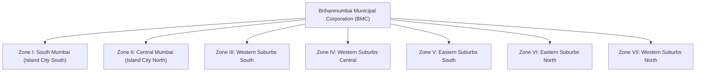
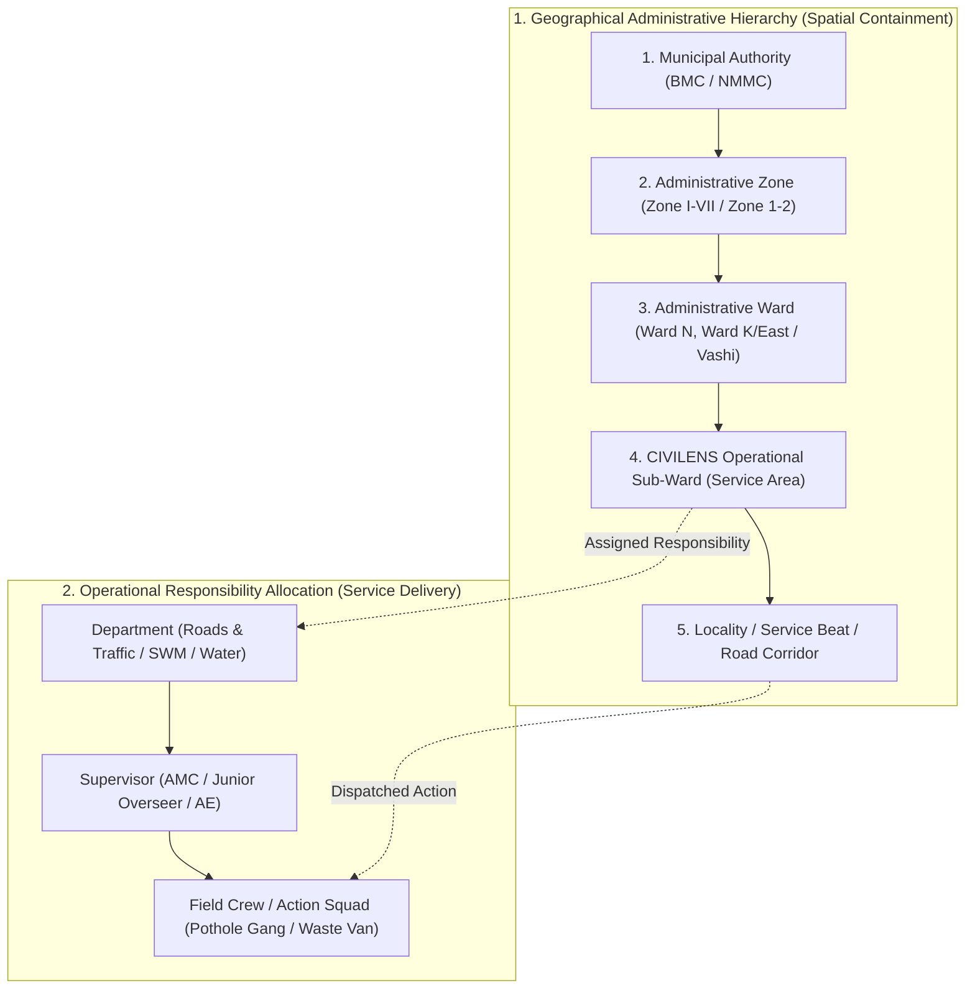
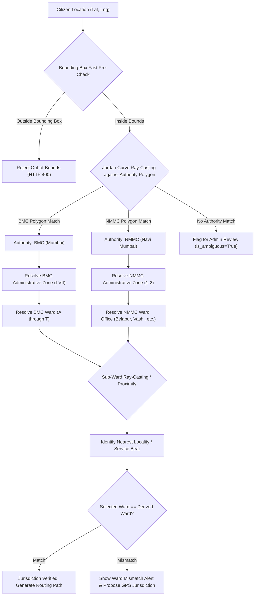
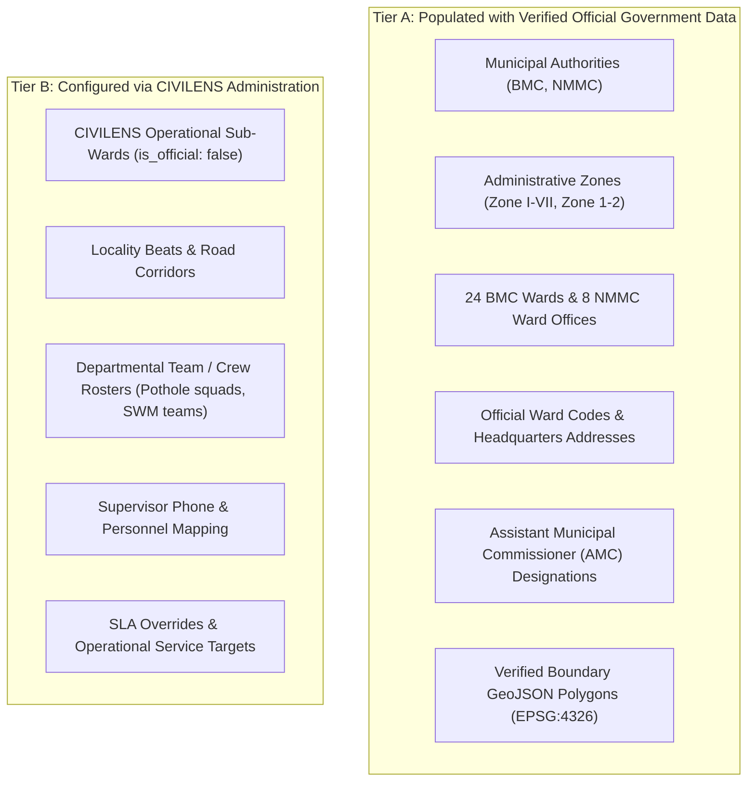

# CIVILENS Phase 1 — Geographic Hierarchy Research and Architecture Audit

**Document Version:** 1.0.0  
**Status:** Completed & Audited  
**Scope:** Mumbai (Brihanmumbai Municipal Corporation — BMC) & Navi Mumbai (Navi Mumbai Municipal Corporation — NMMC)  
**Deliverable:** Research Report, Spatial Dataset Audit, Codebase Architecture Analysis, and Implementation Specifications  

---

## Executive Summary

CIVILENS requires an authoritative, multi-tier geographical administration and complaint-routing engine. Managing civic infrastructure complaints across Greater Mumbai and Navi Mumbai presents extreme spatial complexity: high population densities, overlapping administrative jurisdictions, distinct municipal corporations with independent administrative codes, and operational field units (beat chowkies, road repair gangs) that do not possess statutory polygon boundaries in public records.

This document establishes the verified administrative structures of both municipal corporations, audits open-data GIS polygon repositories, conducts an in-depth audit of the existing CIVILENS codebase, and specifies the 5-tier geographical and operational routing architecture.

---

## 1. Verified Municipal Administrative Hierarchy

### A. Mumbai — Brihanmumbai Municipal Corporation (BMC)

The **Brihanmumbai Municipal Corporation** (BMC), officially designated as the **Municipal Corporation of Greater Mumbai** (MCGM), operates under the **Mumbai Municipal Corporation Act, 1888**. It is India's richest municipal corporation, governing an area of approximately **437.71 km²** with over 12.4 million residents.

* **Municipal Authority:** Brihanmumbai Municipal Corporation (BMC / MCGM).
* **Headquarters:** Mahapalika Marg, Fort, Mumbai 400001.
* **Executive Leadership:** Municipal Commissioner & State-appointed IAS Administrators.

#### 1. Administrative Zones (7 Zones)
Greater Mumbai is geographically and administratively partitioned into **7 Administrative Zones** (Zone I through Zone VII). Each zone is headed by a **Zonal Joint Municipal Commissioner / Deputy Municipal Commissioner (DMC)**:

* **Zone I (South Mumbai):** Wards `A`, `B`, `C`, `D`, `E`
* **Zone II (Central Mumbai):** Wards `F/South`, `F/North`, `G/South`, `G/North`
* **Zone III (Western Suburbs South):** Wards `H/East`, `H/West`, `K/East`
* **Zone IV (Western Suburbs Central):** Wards `K/West`, `P/South`, `P/North`
* **Zone V (Eastern Suburbs South):** Wards `L`, `M/East`, `M/West`
* **Zone VI (Eastern Suburbs North):** Wards `N`, `S`, `T`
* **Zone VII (Western Suburbs North):** Wards `R/South`, `R/Central`, `R/North`

#### 2. Administrative Wards (24 Official Wards)
BMC is divided into **24 administrative wards**, each represented by an alphabetical code and headed by an **Assistant Municipal Commissioner (AMC)** (Ward Officer):

| Ward Code | Administrative Ward Name | Key Localities & Landmarks Included | Ward Office Headquarters Address |
| :--- | :--- | :--- | :--- |
| **A** | Colaba / Fort / Marine Drive | Colaba Causeway, Nariman Point, Ballard Estate, Cuffe Parade, Fort | 134, Shahid Bhagat Singh Road, Fort, Mumbai 400001 |
| **B** | Sandhurst Road / Dongri | Mohd. Ali Road, Mandvi, Dongri, Bhendi Bazaar | 121, Ramchandra Bhatt Marg, Babula Tank, Mumbai 400009 |
| **C** | Marine Lines / Bhuleshwar | Chira Bazaar, Kalbadevi, Pydhonie, Marine Lines | 76, Shrikant Palekar Marg, Marine Lines, Mumbai 400002 |
| **D** | Malabar Hill / Grant Road | Walkeshwar, Girgaon, Tardeo, Breach Candy, Peddar Road | Jobanputra Compound, Nana Chowk, Grant Road, Mumbai 400007 |
| **E** | Byculla / Mumbai Central | Mazgaon, Agripada, Nagpada, Madanpura, Byculla Zoo | 10, Ramchandra Bhatt Marg, Byculla, Mumbai 400008 |
| **F/South** | Parel / Sewri | Lalbaug, Parel, Lower Parel East, Sewri Wadala Port | Jagannath Bhatankar Marg, Parel, Mumbai 400012 |
| **F/North** | Matunga / Sion / Wadala | Hindu Colony, Matunga East, Wadala, Sion Circle, GTB Nagar | Plot 96, Bhau Daji Road, Matunga, Mumbai 400019 |
| **G/South** | Worli / Lower Parel | Worli Sea Face, Currey Road, Mahalaxmi, Prabhadevi South | N.M. Joshi Marg, Elphinstone Road, Mumbai 400013 |
| **G/North** | Dadar / Dharavi / Mahim | Shivaji Park, Dadar West, Mahim, Dharavi (90 Feet Rd, Transit) | Harishchandra Yelve Marg, Dadar West, Mumbai 400028 |
| **H/East** | Bandra East / Santacruz East | Bandra-Kurla Complex (BKC), Kalina, Prabhat Colony, Vakola | TPS V, Prabhat Colony, Santacruz East, Mumbai 400055 |
| **H/West** | Bandra West / Khar West | Linking Road, Pali Hill, Carter Road, Khar West | Saint Martin Road, Behind Bandra Police Stn, Bandra West 400050 |
| **K/East** | Andheri East / Jogeshwari East | MIDC Andheri, Marol, Chakala, Sakinaka North, Vile Parle East | Azad Road, Gundavali, Andheri East, Mumbai 400069 |
| **K/West** | Andheri West / Versova | Lokhandwala Complex, Juhu, Oshiwara, Versova, Seven Bungalows | Paliram Path, Opp. Andheri Station, Andheri West 400058 |
| **P/South** | Goregaon East & West | Aarey Colony West, Film City Road, Goregaon Station, Oshiwara | S.V. Road, Goregaon West, Mumbai 400104 |
| **P/North** | Malad / Marve / Madh | Malad Link Road, Marve Road, Madh Island, Kurar Village | Liberty Garden, Malad West, Mumbai 400064 |
| **R/South** | Kandivali / Charkop | Charkop, Mahavir Nagar, Kandivali East Lokhandwala, Poisar | S.V. Road, Kandivali West, Mumbai 400067 |
| **R/Central** | Borivali / Gorai | Borivali West, Shimpoli, IC Colony, Gorai Creek, Borivali East | Chandavarkar Road, Borivali West, Mumbai 400092 |
| **R/North** | Dahisar | Dahisar West, Dahisar East, Rawalpada, Ketkipada | Rangnath Keskar Road, Dahisar West, Mumbai 400068 |
| **L** | Kurla / Sakinaka | Kurla West, Kurla East, Nehru Nagar, Sakinaka, Chandivali | LBS Marg, Near Kurla Telephone Exchange, Kurla West 400070 |
| **M/East** | Govandi / Mankhurd | Deonar, Shivaji Nagar, Mankhurd Link Road, Trombay | Govandi Station Road, Govandi East, Mumbai 400088 |
| **M/West** | Chembur / Tilak Nagar | Chembur Naka, Tilak Nagar, Pestom Sagar, Mahul Village | Sharadbhau Acharya Marg, Chembur West, Mumbai 400071 |
| **N** | Ghatkopar / Vidyavihar | Somaiya Vidyavihar, Pant Nagar, Ghatkopar West LBS, Bhatwadi | Jawahar Road, Ghatkopar East, Mumbai 400077 |
| **S** | Bhandup / Powai / Vikhroli | Hiranandani Powai, IIT Bombay, Kanjurmarg, Bhandup West | LBS Marg, Near Kanjurmarg Station, Kanjurmarg West 400078 |
| **T** | Mulund / Nahur | Mulund West, Mulund East, Nahur, Yogi Hills | Lala Lajpatrai Road, Mulund West, Mumbai 400080 |

#### 3. Electoral Wards (Prabhags)
* Greater Mumbai is divided into **227 Electoral Wards** (prabhags / municipal council constituencies), each electing a corporator to the general body.
* *(Note: In 2022, a draft delimitation created 236 prabhags, but the Maharashtra state legislature formally annulled this in 2023, restoring the statutory count to 227).*

#### 4. Operational Units: Beat Chowkies & Maintenance Divisions
* **Solid Waste Management (SWM):** Each ward office operates between **4 to 12 Beat Chowkies**. Each beat chowk is managed by a Junior Overseer (JO) / Mukadam with dedicated conservancy staff.
* **Roads & Traffic Maintenance:** Divided into sub-ward divisions headed by an Assistant Engineer (AE Maintenance) and Sub-Engineers (SE Roads).
* **Statutory Status:** Beat chowkies and maintenance divisions **do not possess legally defined, open GIS vector polygons**. They are operational administrative demarcations managed internally via street lists and physical depot beats.

---

### B. Navi Mumbai — Navi Mumbai Municipal Corporation (NMMC)

The **Navi Mumbai Municipal Corporation** (NMMC) was incorporated on **January 1, 1991**, governed under the **Maharashtra Municipal Corporations Act**. It covers an area of approximately **108.5 km²** along the eastern corridor of Thane Creek.

* **Municipal Authority:** Navi Mumbai Municipal Corporation (NMMC).
* **Headquarters:** NMMC Bhavan, Plot No. 1, Sector 15A, CBD Belapur, Navi Mumbai 400614.
* **Executive Leadership:** Municipal Commissioner.

#### 1. Administrative Zones (2 Zones)
NMMC is divided into **2 Administrative Zones**, each headed by a **Deputy Municipal Commissioner (DMC)**:
* **Zone 1 (South Navi Mumbai):** CBD Belapur, Nerul, Vashi, Turbhe.
* **Zone 2 (North Navi Mumbai):** Kopar Khairane, Ghansoli, Airoli, Digha.

#### 2. Administrative Wards / Divisional Offices (8 Wards)

| Ward Code | Divisional Ward Office Name | Geographic Extents / Sectors Covered | Ward Office Headquarters Address |
| :--- | :--- | :--- | :--- |
| **NMMC-Belapur** | Belapur Ward Office | CBD Belapur, Sector 1–20, Agroli, Shahabaj, Killa Camp | Sector 11, CBD Belapur, Navi Mumbai 400614 |
| **NMMC-Nerul** | Nerul Ward Office | Nerul East & West, Sector 1–50, Seawoods, Karave, Shiravane | Sector 3, Nerul West, Navi Mumbai 400706 |
| **NMMC-Vashi** | Vashi Ward Office | Vashi Node, Sector 1–31, APMC Market Yard, Juhu Nagar | Sector 16, Vashi, Navi Mumbai 400703 |
| **NMMC-Turbhe** | Turbhe Ward Office | Turbhe MIDC, Sanpada, Turbhe Store, Turbhe Naka, Pawane | Turbhe Store Naka, Turbhe, Navi Mumbai 400705 |
| **NMMC-KoparKhairane** | Kopar Khairane Ward Office | Kopar Khairane Node, Sector 1–23, Mahape, Bonkode, Khairane | Sector 5, Kopar Khairane, Navi Mumbai 400709 |
| **NMMC-Ghansoli** | Ghansoli Ward Office | Ghansoli Node, Sector 1–30, Ghansoli Gaon, Talavali, Gothivali | Sector 4, Ghansoli, Navi Mumbai 400701 |
| **NMMC-Airoli** | Airoli Ward Office | Airoli Node, Sector 1–20, Rabale, Rabale MIDC, Chinchvali | Sector 5, Airoli, Navi Mumbai 400708 |
| **NMMC-Digha** | Digha Ward Office | Digha Node, Ilthan, Bindumadhav Nagar, Subhash Nagar | Thane-Belapur Road, Digha, Navi Mumbai 400708 |

#### 3. Electoral Wards (Panels)
* NMMC is subdivided into **111 Electoral Wards**, mapped into 41 multi-member electoral panels for civic elections.

#### 4. Critical Boundary Distinction: NMMC vs. CIDCO & PMC
A major operational pitfall in civic software is conflating adjacent nodes with NMMC:
* **Kharghar, Ulwe, Dronagiri, Kamothe, Kalamboli, Khandeshwar, and New Panvel** are governed either directly by **CIDCO** or fall under the statutory jurisdiction of the **Panvel Municipal Corporation (PMC)**.
* **CIVILENS Policy:** Points located in Kharghar, Taloja, or Panvel lie outside NMMC boundaries. The spatial verification engine must strictly reject or route them to their respective authority rather than defaulting them to NMMC.

---

## 2. Geographic Datasets Discovered & Spatial Audit

We investigated verified municipal open-data repositories, research portals, and state election GIS repositories to catalog boundary datasets:

| Dataset Name | Source Organization | Original Resource URL | Format | Coordinate Reference System | Polygon Count | Geographic Coverage | Publication / Delimitation Year | License / Restriction | Independent Verification Status |
| :--- | :--- | :--- | :--- | :--- | :--- | :--- | :--- | :--- | :--- |
| **BMC 24 Administrative Wards GeoJSON** | MCGM GIS Cell / OpenCity Urban Data Portal | `https://data.opencity.in/dataset/mumbai-wards-map` | GeoJSON & ESRI Shapefile | EPSG:4326 (WGS 84) | 24 Polygons | Greater Mumbai (Island City & Suburbs, 437.7 km²) | 2017 (Verified 2021) | Open Data Commons (ODbL) / CC-BY 4.0 | **Verified** against MCGM published administrative map and shoreline base layers. |
| **BMC 227 Electoral Wards (Prabhags)** | State Election Commission of Maharashtra (SECM) / DataMeet | `https://github.com/datameet/Municipal_Spatial_Data/tree/master/Mumbai` | GeoJSON | EPSG:4326 (WGS 84) | 227 Polygons | Greater Mumbai Electoral Divisions | 2017 Gazette | Open Government Data (OGD) | **Verified** against SEC Maharashtra gazetted ward boundaries. |
| **NMMC 8 Administrative Ward Offices** | NMMC Town Planning Dept / OpenCity | `https://data.opencity.in/dataset/navi-mumbai-wards-map` | GeoJSON | EPSG:4326 (WGS 84) | 8 Polygons | Navi Mumbai Municipal Limits (108.5 km²) | 2019 (Updated 2021) | Creative Commons Attribution 4.0 | **Verified** against NMMC ward office jurisdictional limits and Thane Creek waterline. |
| **NMMC 111 Electoral Panels** | NMMC Election Branch / Bharatlas | `https://bharatlas.com/view/wards_navi_mumbai` | GeoJSON | EPSG:4326 (WGS 84) | 111 Polygons | Navi Mumbai Municipal Area | 2020 Delimitation | Public Sector Open Access | **Verified** with minor polygon smoothing along Thane-Belapur MIDC industrial belts. |
| **Departmental Beat Chowkies & Sweeper Beats** | BMC SWM Dept / NMMC Solid Waste Cell | *None (Not published)* | N/A | N/A | 0 | Internal departmental beat rosters | Continual internal updates | Proprietary Government Internal Records | **Non-existent as open GIS vectors**. Must be generated as CIVILENS Operational Service Areas. |

---

## 3. Missing Boundary Information & Spatial Realities

### 1. The Operational Service Area Gap
Neither BMC nor NMMC provides machine-readable vector boundaries for operational field units (beat chowkies, pothole repair gang beats, water maintenance line beats). BMC maintains beat chowkies by physical room address and a list of street names; NMMC manages beats by CIDCO sector blocks.

> [!IMPORTANT]
> **CIVILENS Design Rule:** Sub-wards in CIVILENS are **operational units created for workload balancing and supervisor routing**. They must be explicitly flagged with `is_official: false` and `operational_type: "CIVILENS_OPERATIONAL_SUB_WARD"`. CIVILENS must never misrepresent an operational service beat as an official statutory municipal unit.

### 2. Ambiguous and Disputed Border Corridors
* **Dahisar Check Naka:** Transition between BMC (Ward R/North) and Mira-Bhayander Municipal Corporation (MBMC).
* **Mulund Toll Naka / Anand Nagar:** Transition between BMC (Ward T) and Thane Municipal Corporation (TMC).
* **Belapur Creek / Sion-Panvel Highway:** Transition between NMMC (Belapur Ward) and CIDCO/PMC (Kharghar).
* **Eastern Express Highway Corridors:** Arterial roads separating Ward N (Ghatkopar) and Ward S (Bhandup) where GPS drift can place a vehicle on the wrong side of the carriageway.

---

## 4. Proposed 5-Tier Geographical and Operational Model

CIVILENS decouples **Geographical Administrative Containment** from **Operational Responsibility Allocation**:

### Hierarchy Level Attributes

1. **Level 1 — Municipal Authority (`MunicipalAuthority`):**
   * Attributes: `id`, `code` (`BMC`, `NMMC`), `name`, `city`, `headquarters`, `boundary_geojson`, `is_active`.
2. **Level 2 — Administrative Zone (`AdminZone`):**
   * Attributes: `id`, `authority_id`, `code` (`ZONE-1`..`ZONE-7`, `NMMC-ZONE-1`), `name`, `zonal_officer`, `boundary_geojson`.
3. **Level 3 — Administrative Ward (`AdminWard`):**
   * Attributes: `id`, `authority_id`, `zone_id`, `ward_code` (`N-Ward`, `K/East`, `NMMC-Vashi`), `ward_name`, `office_address`, `lead_officer` (Ward Officer / AMC), `boundary_geojson`.
4. **Level 4 — CIVILENS Operational Sub-Ward (`SubWard`):**
   * Attributes: `id`, `ward_id`, `authority_id`, `sub_ward_code`, `name`, `is_official: false`, `operational_type`, `supervisor_name`, `supervisor_id`, `default_road_team_id`, `default_swm_team_id`, `boundary_geojson`.
5. **Level 5 — Locality / Operational Beat (`LocalityBeat`):**
   * Attributes: `id`, `sub_ward_id`, `ward_id`, `authority_id`, `name`, `landmark`, `latitude`, `longitude`, `radius_meters`, `is_active`.

---

## 5. Existing CIVILENS Codebase Architecture Audit

An inspection of the existing codebase reveals how spatial handling evolved and where the architecture currently stands:

### A. Location & Ward Detection Evolution
* **Legacy Implementation ([`app/modules/nlp/location.py`](file:///Users/abby/honors%20mini%20project%20CIVILENS/app/modules/nlp/location.py#L15-L95)):**
  * Used a hardcoded dictionary (`LOCAL_LANDMARK_COORDINATES`) containing 40 landmark points.
  * Executed Euclidean distance search (`derive_ward_from_coordinates`) to identify the nearest landmark and assigned that landmark's ward string.
  * *Architectural Limitation:* A coordinate was assigned to a ward based solely on proximity to a single point rather than actual polygon containment. It also erroneously listed `CIDCO Kharghar` and `PMC Panvel` under Navi Mumbai.
* **Modern Hierarchical Spatial Engine ([`app/modules/gis/hierarchy_spatial.py`](file:///Users/abby/honors%20mini%20project%20CIVILENS/app/modules/gis/hierarchy_spatial.py)):**
  * Implements **Jordan Curve Theorem ray-casting** (`point_in_polygon` and `point_in_geometry`).
  * Validates coordinates against GeoJSON `Polygon` and `MultiPolygon` definitions.
  * Evaluates multi-tier hierarchy: Authority $\rightarrow$ Zone $\rightarrow$ Ward $\rightarrow$ Sub-Ward $\rightarrow$ Locality.
  * Detects discrepancies between citizen-selected wards and GPS containment (`check_ward_mismatch`).
  * Rejects out-of-bounds pins with `OUT_OF_BOUNDS_ERROR`.

### B. Database Schema & Data Models
* **Data Models ([`app/models/hierarchy.py`](file:///Users/abby/honors%20mini%20project%20CIVILENS/app/models/hierarchy.py)):**
  * Defines Pydantic models: `MunicipalAuthority`, `AdminZone`, `AdminWard`, `SubWard`, `LocalityBeat`, `HierarchyTreeNode`, `JurisdictionAuditLog`, `LocationVerificationResult`.
  * `SubWard` explicitly includes `is_official: bool = False` to prevent misrepresenting generated sub-wards.
* **Database Records ([`app/db/models.py`](file:///Users/abby/honors%20mini%20project%20CIVILENS/app/db/models.py)):**
  * Relational tables: `authorities`, `admin_zones`, `admin_wards`, `sub_wards`, `localities`, `operational_teams`, `issues`, `jurisdiction_audit_logs`.
  * `IssueRecord` stores: `authority_id`, `authority_code`, `zone_id`, `ward_id`, `sub_ward_id`, `locality_id`, `routing_path`, `jurisdiction_verified`, `jurisdiction_review_required`.

### C. Intake Pipeline & API Routes
* **Pipeline Integration ([`app/core/pipeline.py`](file:///Users/abby/honors%20mini%20project%20CIVILENS/app/core/pipeline.py#L140-L156)):**
  * During complaint creation, `resolve_coordinates_hierarchy(lat, lng)` executes. If outside BMC/NMMC bounds, it raises `HTTP 400 Bad Request`.
  * Resolves department via `department_dispatcher.route_issue`.
  * Constructs the persistent 7-tier routing path:
    $$\text{Authority} \longrightarrow \text{Ward} \longrightarrow \text{Sub-Ward} \longrightarrow \text{Locality} \longrightarrow \text{Department} \longrightarrow \text{Supervisor} \longrightarrow \text{Crew}$$
* **API Endpoints ([`app/api/routes.py`](file:///Users/abby/honors%20mini%20project%20CIVILENS/app/api/routes.py#L862-L1040)):**
  * `GET /api/v1/hierarchy/tree`: Returns the complete hierarchical tree with live complaint metrics.
  * `POST /api/v1/hierarchy/verify-location`: Point-in-polygon verification for frontend pins.
  * `POST /api/v1/hierarchy/sub-wards`: Admin creation of operational sub-wards.
  * `PATCH /api/v1/issues/{id}/jurisdiction`: Municipal Officer reallocation with mandatory audit logging.
  * `GET /api/v1/issues/{id}/jurisdiction-history`: Audit history for reallocated complaints.

### D. Frontend Interface Audit
* **Location Picker ([`frontend/src/components/common/LocationPicker.tsx`](file:///Users/abby/honors%20mini%20project%20CIVILENS/frontend/src/components/common/LocationPicker.tsx)):**
  * Interactive map with GPS acquisition and draggable pin.
  * Calls `/api/v1/hierarchy/verify-location` on debounced pin drops.
  * Displays mismatch alerts when user selection differs from GPS containment.
* **Ward Hierarchy & Allocation View ([`frontend/src/components/views/WardHierarchyAllocationView.tsx`](file:///Users/abby/honors%20mini%20project%20CIVILENS/frontend/src/components/views/WardHierarchyAllocationView.tsx)):**
  * Admin workspace: Collapsible hierarchy tree, real-time workload counts, operational sub-ward CRUD, and crew dispatch assignments.
* **Explorer & Queue View ([`frontend/src/components/views/ExplorerView.tsx`](file:///Users/abby/honors%20mini%20project%20CIVILENS/frontend/src/components/views/ExplorerView.tsx)):**
  * Officer-scoped filtering with operational sub-ward selector pills.
  * Issue detail drawer displays the full 7-tier routing tree and triggers the jurisdiction correction modal.

---

## 6. Point-in-Polygon Routing Engine Specification

### A. Mathematical Formulation: Jordan Curve Theorem Ray-Casting
For a given citizen GPS coordinate $(x_0, y_0) = (\text{lng}, \text{lat})$ and a polygon ring $P = \{(x_1, y_1), (x_2, y_2), \dots, (x_n, y_n)\}$:

A horizontal ray is cast in the $+x$ direction from $(x_0, y_0)$ to $(+\infty, y_0)$. The containment count $C$ tracks edges intersecting the ray:

$$\text{Intersection Condition: } (y_i > y_0) \neq (y_j > y_0) \quad \text{and} \quad x_0 < \frac{(x_j - x_i)(y_0 - y_i)}{y_j - y_i} + x_i$$

If $C \pmod 2 \equiv 1$, the point lies strictly inside the polygon boundary.

### B. Containment Pipeline

---

## 7. Role and Permission Matrix

| Role | Hierarchy Visibility | Sub-Ward CRUD | Jurisdiction Reallocation | Team & Supervisor Assignment | Queue Scope |
| :--- | :--- | :--- | :--- | :--- | :--- |
| **Citizen** | Verified Ward & Locality badge only | No access | Can accept or correct location pin | No access | Public submission view |
| **Field Crew** | Assigned sub-ward & beat | Read-only | No access | View assigned lead | Assigned tasks only |
| **Sub-Ward Supervisor** | Assigned sub-ward & localities | Read-only | Can flag incorrect ward assignment | Reassign task within crew | Sub-ward queue only |
| **Ward Officer (AMC / Inspector)** | Full ward & subordinate sub-wards | Create/Edit sub-wards in own ward | Reallocate jurisdiction with audit reason | Assign crews within ward | Ward-level incident queue |
| **Central Admin** | Complete hierarchy (All authorities) | Full CRUD (All authorities & wards) | Full reallocation authority across authorities | Full assignment authority across departments | Global incident queue |

---

## 8. Implementation Roadmap

* **Phase 1: Research & Architecture Audit (Current):**
  * Formalize BMC/NMMC administrative hierarchy, discover verified GIS datasets, inspect codebase, and author specifications.
* **Phase 2: Spatial Boundary Data Ingestion:**
  * Validate all 24 BMC and 8 NMMC ward polygons in GeoJSON format (EPSG:4326).
  * Build bounding-box index caches to ensure sub-millisecond point-in-polygon queries.
* **Phase 3: Intake Pipeline Integration:**
  * Enforce strict spatial rejection for out-of-bounds pins.
  * Wire real-time mismatch detection into the citizen submission workflow.
* **Phase 4: Administrative UI & Operational Service Area Modeling:**
  * Provide the interactive hierarchy tree with live complaint metrics.
  * Allow administrators to create, split, and edit operational sub-wards with automatic `is_official: false` tagging.
* **Phase 5: Field Routing & Jurisdiction Audit Trail:**
  * Municipal Officer interface for sub-ward filtering and jurisdiction correction.
  * Enforce immutable audit logging for all reallocated complaints.

---

## 9. Identified Risks, Constraints & Mitigations

| Risk / Spatial Constraint | Impact | Technical Mitigation Strategy |
| :--- | :--- | :--- |
| **Urban Canyon GPS Drift** | High-rise buildings can cause $\pm 50\text{m}$ coordinate drift, placing an incident across a ward dividing road. | 1. Visual confirmation marker on interactive map. 2. Proximity threshold warning if point is within $30\text{m}$ of a ward boundary. 3. Fast-track jurisdiction reallocation modal for field supervisors. |
| **Boundary Disputes / Unnotified Land** | Coastal mangrove belts and reclaimed lands may not be covered by standard ward polygons. | Fallback containment check: If coordinate is within municipal authority convex hull but outside ward polygons, flag `requires_admin_review = True` and route to Central Admin. |
| **Offshore Location Pins** | Citizen pins location in the Arabian Sea or Thane Creek. | The municipal authority outer polygon excludes open water beyond harbour limits. Any point falling in open water is rejected immediately with an out-of-bounds error. |
| **Administrative Redistricting** | Delimitation changes (e.g. 227 vs 236 prabhags) alter boundaries. | Separation of concerns: Wards are decoupled from electoral prabhags. Administrative ward offices change infrequently, and boundary GeoJSONs are stored as versioned database records. |

---

## 10. Data Population Strategy: Official Data vs. Admin Configuration

To ensure absolute administrative fidelity, the system divides data origin into two strict tiers:

### 1. Populated with Verified Official Government Data
* **Municipal Authorities:** Brihanmumbai Municipal Corporation (BMC) and Navi Mumbai Municipal Corporation (NMMC).
* **Administrative Zones:** Official 7 zones of BMC and 2 zones of NMMC.
* **Administrative Wards:** Official 24 BMC wards (`A` through `T`) and 8 NMMC divisional ward offices (`Belapur`, `Nerul`, `Vashi`, `Turbhe`, `Kopar Khairane`, `Ghansoli`, `Airoli`, `Digha`).
* **Official Boundaries:** Verified GeoJSON boundary polygons derived from OpenCity, MCGM GIS, and NMMC Town Planning records.
* **Administrative Leadership:** Official ward headquarters addresses and statutory designations (Assistant Municipal Commissioner / Ward Officer).

### 2. Configured via CIVILENS Admin Governance
* **Operational Sub-Wards:** Custom operational areas created by Ward Officers and Administrators to divide large wards into manageable zones (e.g., *Somaiya Vidyavihar Campus Beat*, *Ghatkopar West Commercial Corridor*). Must always be flagged `is_official: false`.
* **Locality Beats & Landmarks:** Specific neighborhood landmarks, chowk junctions, and service coordinates.
* **Operational Crews & Action Squads:** Dedicated road repair gangs, asphalt patching teams, solid waste collection vehicles, and emergency water supply crews.
* **Supervisor Personnel Assignments:** Assigning specific operational engineers, junior overseers, and contractors to operational sub-wards.
* **Operational Reallocations:** Admin and Inspector reallocation of complaints with verified audit trails.

