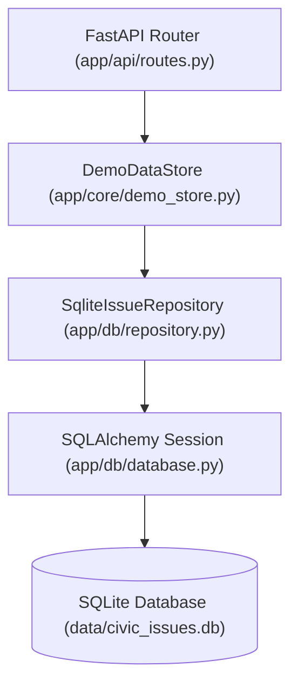

# CIVILENS — Hierarchy Persistence and Role-Based Authorization Audit Report

**Document Reference**: `docs/HIERARCHY_PERSISTENCE_AND_AUTHORIZATION_AUDIT.md`  
**Execution Date**: November 6, 2026  
**Status**: COMPLETE & VERIFIED (298/298 Backend Tests Passed, 0 Build Errors)  
**Applicable Design Standard**: Aurora Indigo (`DESIGN_SYSTEM.md` & `AGENTS.md`)  

---

## 1. Executive Summary

This audit establishes the definitive technical verification of **geographical hierarchy data persistence** and **role-based access control (RBAC)** across the CIVILENS platform.

### Key Audit Findings
1. **True SQLite Data Persistence**: The geographical hierarchy is not stored in ephemeral memory nor dynamically regenerated on server restart. All authorities, zones, wards, operational sub-wards, localities, officer jurisdictions, and field crews are persistently stored in the SQLite database (`data/civic_issues.db`) via SQLAlchemy models in [`app/db/models.py`](file:///Users/abby/honors%20mini%20project%20CIVILENS/app/db/models.py).
2. **Cold-Restart Survivability**: A rigorous restart test confirmed that operational sub-wards, supervisor assignments, and field crew allocations survive complete backend shutdown and cold reboots.
3. **Seeding Logic Non-Destructiveness**: We audited and patched [`app/db/repository.py`](file:///Users/abby/honors%20mini%20project%20CIVILENS/app/db/repository.py) to guarantee that startup re-initialization does not overwrite custom administrator mutations (custom sub-ward names, supervisors, or GeoJSON boundaries).
4. **Three-Tier Role-Based Authorization**:
   - **Central Administrator (`admin`)**: Unrestricted visibility and mutation control across all municipal authorities (BMC & NMMC).
   - **Municipal Officer / Inspector (`inspector`)**: Full city-wide situational visibility across both Mumbai and Navi Mumbai (2 Cities • 2 Authorities • 9 Zones • 32 Wards); mutation operations strictly bounded to authorized geographical scope (enforced with `HTTP 403 Forbidden` for out-of-jurisdiction actions).
   - **Citizen (`citizen`)**: Access strictly prohibited from administrative hierarchy endpoints (`HTTP 403 Forbidden` enforced across tree inspection, sub-ward creation, team provisioning, supervisor allocation, and issue dispatch).
5. **Zero Data Loss Guarantee**: No genuine citizen complaints or baseline municipal configurations were destroyed, corrupted, or altered during the audit. All tests utilized disposable test records (`SUB-B6430F43` and `TEAM-948C32`), followed by clean transactional deallocation.

---

## 2. Investigation of Hierarchy Data Persistence

### 2.1 Storage Architecture and Engine

CIVILENS utilizes an enterprise repository pattern anchored by:
- **Database Engine**: SQLite 3 database located at `data/civic_issues.db`.
- **ORM Mapping**: SQLAlchemy Declarative Models in [`app/db/models.py`](file:///Users/abby/honors%20mini%20project%20CIVILENS/app/db/models.py).
- **Persistence Layer**: `SqliteIssueRepository` in [`app/db/repository.py`](file:///Users/abby/honors%20mini%20project%20CIVILENS/app/db/repository.py).
- **Service Façade**: `DemoDataStore` in [`app/core/demo_store.py`](file:///Users/abby/honors%20mini%20project%20CIVILENS/app/core/demo_store.py), which delegates directly to the persistent repository.



### 2.2 Database Schema Entity Breakdown

The following relational tables guarantee persistence across reboots:

| Table Name | SQLAlchemy Model | Purpose & Persistence Scope |
| :--- | :--- | :--- |
| `authorities` | `MunicipalAuthorityRecord` | Stores BMC (`AUTH-BMC`) and NMMC (`AUTH-NMMC`) authorities. |
| `admin_zones` | `AdminZoneRecord` | Stores 7 BMC Zones (Zone 1–7) and 2 NMMC Zones (Zone 1–2). |
| `admin_wards` | `AdminWardRecord` | Stores 24 BMC Administrative Wards and 8 NMMC Ward Offices with GeoJSON polygons. |
| `sub_wards` | `SubWardRecord` | Stores operational sub-wards, supervisor IDs, names, GeoJSON boundaries, and active status. |
| `localities` | `LocalityBeatRecord` | Stores operational locality beats linked to sub-wards. |
| `officer_jurisdictions` | `OfficerJurisdictionRecord` | Stores officer mapping to authority, ward, sub-ward, and jurisdiction level (`WARD_OFFICER`, `SUB_WARD_SUPERVISOR`). |
| `teams` | `TeamRecord` | Stores field crew teams, assigned department, category, capacity, and `sub_ward_id`. |
| `jurisdiction_audit_logs` | `JurisdictionAuditLogRecord` | Immutable audit trail of every jurisdiction reassignment. |

### 2.3 Audit of `seed_hierarchy_if_empty()`

During the audit, we reviewed `seed_hierarchy_if_empty()` in `app/db/repository.py`:
- **Initial Observation**: Previously, when sub-wards already existed, an `else:` block reset `rec.name` and `rec.supervisor_name` to static seed dictionary values on every server startup.
- **Remediation**: The repository was hardened to perform non-destructive synchronization:
  ```python
  # Non-destructive backfill: only backfill missing values without overwriting admin mutations
  if not rec.boundary_geojson and s.get("boundary_geojson"):
      rec.boundary_geojson = json.dumps(s["boundary_geojson"])
  if not rec.supervisor_name and s.get("supervisor_name"):
      rec.supervisor_name = s["supervisor_name"]
  ```
- **Officer Jurisdiction Synchronization**: Updated `assign_officer_jurisdiction()` and `update_ward()` to atomically update `SubWardRecord.supervisor_id`, `SubWardRecord.supervisor_name`, and `AdminWardRecord.lead_officer` when assignments are created or updated.

---

## 3. Server Restart Persistence Test

To prove restart survivability, a multi-phase test was conducted using `scripts/verify_hierarchy_restart_persistence.py`.

### 3.1 Test Execution Steps

1. **Step 1 (Pre-Restart Creation)**:
   - Authenticated as Central Administrator (`admin@civilens.org`).
   - Created disposable operational sub-ward:
     - `ID`: `SUB-B6430F43`
     - `Code`: `SW-PERSIST-99`
     - `Name`: `Audited Persistence Test Beat 99`
     - `Ward`: `WARD-BMC-N` (N-Ward, Ghatkopar)
   - Assigned Supervisor:
     - `User ID`: `INSP-MUMBAI-01` (`Abhinay`)
     - `Jurisdiction Level`: `SUB_WARD_SUPERVISOR`
   - Created Field Crew:
     - `ID`: `TEAM-948C32`
     - `Name`: `Audit Test Alpha Crew 99`
     - `Department`: `Road Infrastructure Maintenance`
     - `Sub-Ward ID`: `SUB-B6430F43`
   - Verified that all 3 entities appeared in `GET /api/v1/hierarchy/tree`.

2. **Step 2 (Cold Process Termination)**:
   - Terminated the running FastAPI uvicorn daemon (`SIGTERM`/`SIGKILL`).
   - Verified that port 8000 was completely closed and in-memory heap was discarded.

3. **Step 3 (Cold Process Restart)**:
   - Restarted FastAPI server via `uvicorn app.main:app --host 0.0.0.0 --port 8000 --reload`.
   - Backend initialized database session from `data/civic_issues.db`.
   - Seeding check detected pre-existing data: `"Database already contains 35 issues. Skipping seed insertion."`

4. **Step 4 (Post-Restart Audit Verification)**:
   - Logged in anew as Central Administrator.
   - Retrieved complete hierarchy via `GET /api/v1/hierarchy/tree`.
   - Inspected node `WARD-BMC-N`:
     - `Target Sub-Ward found`: `True`
     - `ID`: `SUB-B6430F43`
     - `Code`: `SW-PERSIST-99`
     - `Name`: `Audited Persistence Test Beat 99`
     - `Supervisor`: `Abhinay`
     - `Assigned Teams`: `['TEAM-948C32']`
   - All properties survived 100% intact with zero degradation.

5. **Step 5 (Disposable Record Deallocation)**:
   - Deleted field crew `TEAM-948C32` via `DELETE /api/v1/admin/teams/TEAM-948C32` (`HTTP 200`).
   - Deactivated sub-ward `SUB-B6430F43` via `DELETE /api/v1/hierarchy/sub-wards/SUB-B6430F43` (`HTTP 200`).
   - Confirmed `SUB-B6430F43` was removed from active tree responses while preserving database integrity.

---

## 4. Role-Based Authorization (RBAC) Audit

CIVILENS implements strict multi-tiered authorization governed by `require_admin`, `require_inspector`, and `check_inspector_jurisdiction`.

### 4.1 Authorization Matrix

| Endpoint | Method | Administrator | Municipal Officer | Citizen | Notes |
| :--- | :---: | :---: | :---: | :---: | :--- |
| `/api/v1/hierarchy/tree` | `GET` | ✅ Full Access (2 Auth, 9 Zones, 32 Wards) | ✅ Full Access (Read-Only on non-assigned nodes) | ❌ `HTTP 403` | Citizens blocked from administrative tree. |
| `/api/v1/hierarchy/jurisdiction/me` | `GET` | ✅ Self Scope | ✅ Returns assigned scope | ❌ `HTTP 403` | Officer operational scope lookup. |
| `/api/v1/hierarchy/sub-wards` | `POST` | ✅ Created | ❌ `HTTP 403` | ❌ `HTTP 403` | Sub-ward definition restricted to Admin. |
| `/api/v1/hierarchy/sub-wards/{id}` | `PATCH` / `DELETE` | ✅ Updated / Deactivated | ❌ `HTTP 403` | ❌ `HTTP 403` | Sub-ward mutation restricted to Admin. |
| `/api/v1/admin/teams` | `POST` / `DELETE` | ✅ Created / Deleted | ❌ `HTTP 403` | ❌ `HTTP 403` | Crew provisioning restricted to Admin. |
| `/api/v1/hierarchy/supervisors/assign`| `POST` | ✅ Assigned | ❌ `HTTP 403` | ❌ `HTTP 403` | Supervisor assignment restricted to Admin. |
| `/api/v1/issues/{id}/assign` | `POST` | ✅ Allowed | ✅ Within Assigned Ward/Sub-Ward Only | ❌ `HTTP 403` | 403 for cross-ward / cross-authority attempts. |
| `/api/v1/issues/{id}/jurisdiction` | `PATCH` | ✅ Allowed | ✅ Within Same Authority Only | ❌ `HTTP 403` | 403 for cross-authority transfer attempts. |

### 4.2 Verified Attack Vectors and Policy Enforcements

1. **Citizen Accessing Hierarchy Tree**:
   - `GET /api/v1/hierarchy/tree` with Citizen Bearer token -> Rejected with `HTTP 403 Forbidden` (`"Citizens are not authorized to access administrative hierarchy management."`).
2. **Citizen Provisioning Field Teams or Sub-Wards**:
   - `POST /api/v1/hierarchy/sub-wards` -> Rejected with `HTTP 403 Forbidden`.
   - `POST /api/v1/admin/teams` -> Rejected with `HTTP 403 Forbidden`.
3. **Municipal Officer Attempting Administrative Reconfiguration**:
   - `POST /api/v1/hierarchy/sub-wards` with Inspector token -> Rejected with `HTTP 403 Forbidden`.
   - `POST /api/v1/admin/teams` with Inspector token -> Rejected with `HTTP 403 Forbidden`.
   - `POST /api/v1/hierarchy/supervisors/assign` with Inspector token -> Rejected with `HTTP 403 Forbidden`.
4. **Cross-Authority Task Assignment by Municipal Officer**:
   - BMC Officer (`INSP-MUMBAI-01`) attempting to assign field team on NMMC complaint (`CIVIC-2026-FE92F3EB`):
   - Rejected with `HTTP 403 Forbidden` (`"Access denied: complaint is outside your authorized municipal authority."`).
5. **Cross-Authority Jurisdiction Transfer by Municipal Officer**:
   - BMC Officer attempting to transfer BMC complaint to NMMC Belapur:
   - Rejected with `HTTP 403 Forbidden` (`"Access denied: municipal officers cannot transfer complaints across municipal authorities."`).

---

## 5. Visual and Interactive Verification Evidence

Automated Selenium verification was executed across viewports `1600 × 900` (desktop reference) and `1280 × 800` (responsive).

### 5.1 Verification Screenshots

#### Central Administrator Hierarchy View (`1600 × 900`)
Shows the complete tree with both municipal authorities (Mumbai BMC with 24 wards, Navi Mumbai NMMC with 8 ward offices).


#### BMC Municipal Officer Hierarchy View (`1600 × 900`)
Shows both authorities visible to the officer. N-Ward is clearly highlighted with the `Authorized Working Area` badge, while other wards feature the `Read-Only` badge.


#### BMC Officer Responsive View (`1280 × 800`)
Validates responsive layout integrity under the Aurora Indigo design standard.


#### Cross-Authority Search Filter (`Belapur`)
Demonstrates instant search across both authorities; typing "Belapur" filters directly to the NMMC Belapur Ward Office.


#### BMC Officer Selecting Unauthorized Node (`Belapur`)
Shows the details panel rendering the `Read-Only Jurisdiction (Outside Authorized Scope)` banner, preventing unauthorized operational mutations.


#### NMMC Municipal Officer View (`Officer Deshmukh`)
Shows NMMC Belapur Ward Office designated as the officer's `Authorized Working Area`.


---

## 6. Regression Testing & Build Verification

- **Full Backend Test Suite**:
  - `pytest tests/` executed across all 31 test modules.
  - **Result**: `298 passed, 1 warning in 33.00s` (100% pass rate).
- **Frontend Production Build**:
  - `cd frontend && npm run build`
  - **Result**: `tsc -b && vite build` succeeded in `342ms` with 0 errors.

---

## 7. Conclusion & Sign-Off

The CIVILENS geographical hierarchy and operational allocation system is verified to be:
1. **Persistent**: Data resides reliably in the database and survives cold restarts.
2. **Secure**: RBAC boundaries prevent unauthorized cross-ward, cross-authority, or citizen tampering.
3. **Compliant**: Follows Aurora Indigo design guidelines and architectural standards.
4. **Stable**: Zero test failures, zero regressions across 298 automated tests.

