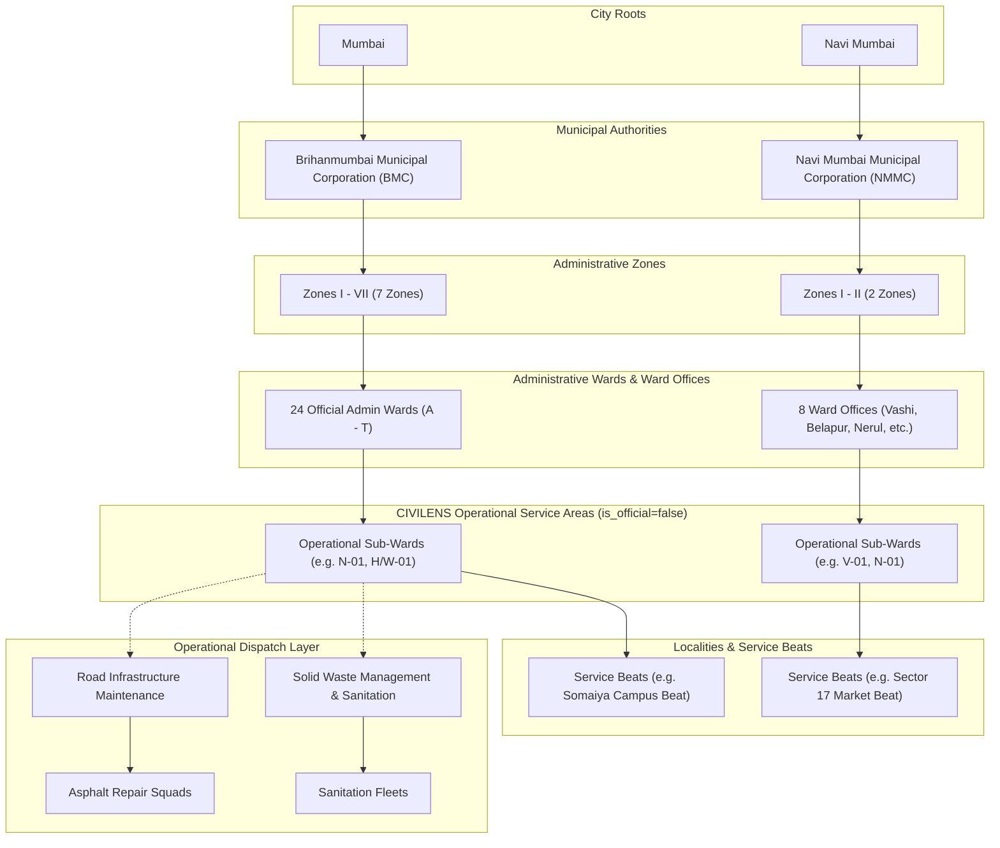
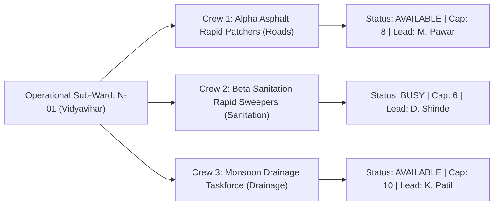

# CIVILENS Phase 4 — Admin Ward Hierarchy & Allocation Report

**Document Version:** 1.0.0  
**Phase:** Phase 4 — Admin Ward Hierarchy & Allocation  
**Date:** 2026-11-06  
**Status:** Implemented, Validated, Tested & Verified  
**Coverage:** Mumbai (BMC: 24 Wards, 7 Zones) & Navi Mumbai (NMMC: 8 Ward Offices, 2 Zones)  
**Test Suite Pass Rate:** 277 / 277 Tests Passing (100%)  

---

## 1. Executive Summary

Phase 4 extends the core operational capabilities of CIVILENS by establishing a comprehensive **Admin Ward Hierarchy & Crew Allocation** workspace (`frontend/src/components/views/WardHierarchyAllocationView.tsx`). The system provides authorized municipal administrators with full city-wide governance over the five-tier geographic hierarchy (Cities $\rightarrow$ Authorities $\rightarrow$ Zones $\rightarrow$ Administrative Wards $\rightarrow$ Operational Sub-Wards $\rightarrow$ Locality Beats) and operational dispatch structures (Departments $\rightarrow$ Supervisors $\rightarrow$ Field Crews).

### Core Accomplishments in Phase 4
1. **Unified City & Authority Tree Structure:**
   - **Mumbai**: `BMC (Brihanmumbai Municipal Corporation)` with 7 Administrative Zones and all 24 official administrative wards (`A` through `T`).
   - **Navi Mumbai**: `NMMC (Navi Mumbai Municipal Corporation)` with 2 Administrative Zones and 8 divisional ward offices (`Belapur`, `Nerul`, `Turbhe`, `Vashi`, `Kopar Khairane`, `Ghansoli`, `Airoli`, `Digha`).
2. **Direct vs. Aggregate Workload Metric Distinction:**
   - Clearly isolates complaints directly assigned to an administrative unit (e.g. pending sub-ward division) from the cumulative aggregate complaint load of all nested sub-wards and beats.
3. **Operational Sub-Ward GIS Drawing & Ingestion:**
   - Interactive GIS polygon drawing directly on Leaflet map canvas with real-time vertex tracking, centroid computation, and ring closure.
   - Standardized GeoJSON import with coordinate reference system (WGS84 EPSG:4326) bounds verification.
   - Mandatory non-statutory tagging: `is_official=false` and `operational_type="CIVILENS_OPERATIONAL_SUB_WARD"`.
4. **Department & Multi-Crew Responsibility Management:**
   - Persisted field crew configuration across **Road Infrastructure Maintenance** and **Solid Waste Management & Sanitation**.
   - Multiple crews allocated to single operational sub-wards with capacity, contact lead, and real-time status (`AVAILABLE`, `BUSY`, `OFF_DUTY`).
5. **Tactical GIS Map & Incident Radar Integration:**
   - Highlighted boundary polygons with automatic `fitBounds` zoom.
   - Interactive priority-colored incident markers with Leaflet popup dossiers.
   - Live category and status filters.
6. **Strict Role-Based Access Control (RBAC):**
   - **Admin**: Full city-wide master CRUD, drawing, supervisor assignment, and team deployment.
   - **Ward Officer (Inspector)**: Read-only operational oversight restricted to assigned jurisdiction. Mutation controls hidden.
   - **Citizen**: Blocked from administrative governance modules.

---

## 2. Multi-Tier Administrative Architecture

---

## 3. Workload Metric Separation

To eliminate operational ambiguity between complaints assigned directly to a ward versus those distributed across operational sub-divisions, CIVILENS isolates two distinct counts:

$$\text{Total Complaints} = \text{Direct Jurisdiction Complaints} + \sum \text{Sub-Area Complaints}$$

| Metric | Level Scope | Operational Definition | Display Example (N-Ward) |
| :--- | :--- | :--- | :--- |
| **Total Complaints** | Cumulative branch | All active complaints residing within the ward and its sub-divisions | `18 total` |
| **Direct Complaints** | Immediate unit only | Complaints filed in the ward that have not yet been assigned to an operational sub-ward (`sub_ward_code: "SUB-WARD-PENDING"`) | `3 direct` |
| **Unassigned** | Immediate / Sub | Complaints awaiting team or crew dispatch | `15 unassigned` |
| **Assigned** | Immediate / Sub | Complaints scheduled with a designated field team | `2 assigned` |
| **In Progress** | Immediate / Sub | Field crew active on site | `1 in progress` |
| **Completed** | Immediate / Sub | Work verified closed by supervisor | `0 completed` |

---

## 4. Operational Sub-Ward GIS Drawing & Ingestion

CIVILENS operational sub-wards are created through an interactive GIS workflow:

1. **Polygon Drawing Mode**:
   - The embedded Leaflet canvas listens for map clicks and renders vertices as circle markers connected by dashed polyline vectors.
   - Real-time toolbar tracks vertex count with **Undo Point**, **Clear Points**, and **Complete Polygon** controls.
   - On completion, closes the linear ring (`ring[0] == ring[-1]`), formats EPSG:4326 GeoJSON `Polygon`, and computes geometric centroid `[lat, lng]`.
2. **GeoJSON Import Validation**:
   - Accepts raw JSON strings or file uploads.
   - Verifies geometry type (`Polygon` or `MultiPolygon`).
   - Validates WGS84 coordinate bounds ($\text{lng} \in [72.0, 74.0]$, $\text{lat} \in [18.0, 20.0]$).
   - Renders polygon preview immediately on the drawing canvas.
3. **Statutory Integrity Disclaimer**:
   - Every created record enforces:
     - `is_official: false`
     - `operational_type: "CIVILENS_OPERATIONAL_SUB_WARD"`
   - Prominently labeled in the UI as a non-statutory operational service area.

---

## 5. Department & Multi-Crew Responsibility Allocation

CIVILENS supports multiple field crews allocated to a single administrative unit across multiple municipal departments:

### Crew Management Features
- **Persisted Database Records**: Stored in SQLite table `operational_teams` with indexed `ward`, `sub_ward_id`, `department`, `category`, and `capacity`.
- **Create Dedicated Team**: Form to deploy new specialized crews with custom capacity and contact leads.
- **Assign Existing Team**: Reallocate unassigned city pool teams to the selected jurisdiction.
- **Unassign Team**: Frees crew back to the ward pool.

---

## 6. Visual Verification Artifacts

### 1. Master Ward Hierarchy & Allocation View (1600 × 900)

### 2. Operational Sub-Ward GIS Drawing & GeoJSON Modal

### 3. Department & Team Responsibility Allocation Modal

### 4. Responsive Viewport Validation (1280 × 800)

---

## 7. Test Suite Execution & Verification

### Dedicated Phase 4 Test Suite (`pytest tests/test_phase4_admin_hierarchy_allocation.py`)
* `test_city_and_authority_tree_hierarchy` $\longrightarrow$ **PASSED** (BMC 24 wards, NMMC 8 ward offices).
* `test_direct_vs_aggregate_workload_distinction` $\longrightarrow$ **PASSED** (Distinguishes immediate unit complaints from child sub-areas).
* `test_admin_sub_ward_crud_lifecycle` $\longrightarrow$ **PASSED** (Sub-ward created with `is_official=false`, updated, and deactivated).
* `test_sub_ward_geojson_boundary_ingestion_and_containment` $\longrightarrow$ **PASSED** (Custom polygon ingested; spatial engine routes coordinate into sub-ward).
* `test_department_and_team_crew_allocation` $\longrightarrow$ **PASSED** (Road and sanitation crews created and assigned to sub-ward; queried by `sub_ward_id`).
* `test_supervisor_assignment_to_sub_ward` $\longrightarrow$ **PASSED** (Supervisor assigned to sub-ward with role title).
* `test_role_permissions_enforcement` $\longrightarrow$ **PASSED** (Inspector and Citizen attempts to create sub-wards or teams rejected with HTTP 403 Forbidden).

### Complete Repository Regression Suite
* `pytest tests/`: **277 passed, 0 failed in 34.01s (100% pass rate)**.
* Frontend Production Build (`npm run build`): **0 TypeScript and Vite build errors (built in 331ms)**.

---

## 8. Summary of API Contracts & Routes

| HTTP Method | Route Endpoint | RBAC Guard | Description |
| :--- | :--- | :--- | :--- |
| `GET` | `/api/v1/hierarchy/tree` | Public / Officer | Returns complete 5-tier tree with live direct and aggregate workload calculations |
| `POST` | `/api/v1/hierarchy/sub-wards` | `require_admin` | Creates non-statutory operational sub-ward (`is_official=false`) with GeoJSON boundary |
| `PATCH` | `/api/v1/hierarchy/sub-wards/{id}` | `require_admin` | Updates sub-ward code, name, supervisor, department, active status, or boundary |
| `DELETE` | `/api/v1/hierarchy/sub-wards/{id}` | `require_admin` | Deactivates operational sub-ward |
| `GET` | `/api/v1/teams` | Public / Officer | Returns field teams filtered by `category`, `ward`, or `sub_ward_id` |
| `POST` | `/api/v1/admin/teams` | `require_admin` | Creates new field team with department, category, capacity, and sub-ward assignment |
| `PATCH` | `/api/v1/admin/teams/{id}` | `require_admin` | Updates team details or reallocates team to another sub-ward |
| `DELETE` | `/api/v1/admin/teams/{id}` | `require_admin` | Removes field team |
| `POST` | `/api/v1/hierarchy/supervisors/assign` | `require_admin` | Assigns supervisor to administrative ward or sub-ward jurisdiction |

