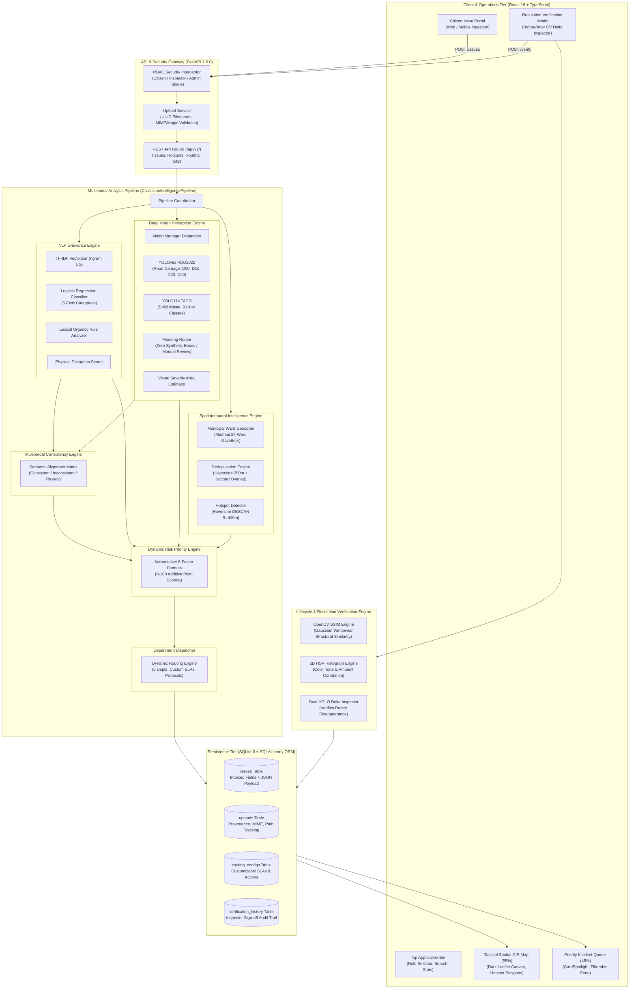
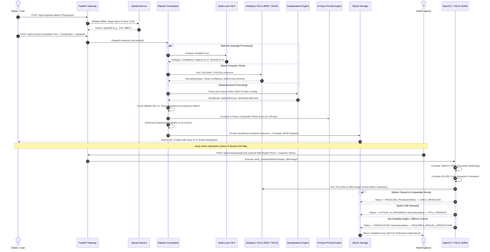

# CIVILENS — Civic Infrastructure Intelligence Platform
## Comprehensive Academic Project Documentation & Viva Defense Guide

---

### Table of Contents
1. **Title Page & Project Metadata**
2. **Abstract**
3. **Problem Statement**
4. **Motivation**
5. **Objectives**
6. **Existing System & Current Limitations**
7. **Proposed Solution**
8. **System Overview**
9. **Key Features (14 Original + 6 Advanced Subsystems)**
10. **Technology Stack & Framework Justifications**
11. **System Architecture (Mermaid & Data Flow)**
12. **Detailed End-to-End Workflow**
13. **Module-wise In-Depth Technical Explanation**
    - Module 1: Multimodal Ingestion & Upload Management
    - Module 2: NLP Grievance Classifier, Urgency & Severity Engines
    - Module 3: Dual Deep Computer Vision Detectors (RDD2022 & TACO)
    - Module 4: Multimodal Text–Image Evidence Consistency Matrix
    - Module 5: Spatiotemporal Geocoding, Near-Duplicate Deduplication & DBSCAN Hotspots
    - Module 6: Risk-Aware 6-Factor Explainable Dynamic Priority Engine
    - Module 7: Configurable Municipal Department Dispatcher & SLA Manager
    - Module 8: Computer Vision Lifecycle Resolution Verification (SSIM + HSV + YOLO)
14. **Dataset, Benchmarks & Training Data Provenance**
15. **Algorithms, Mathematical Formulations & ML Models**
16. **Important Technical Concepts Explained**
17. **Implementation Details (Directory Structure, Execution Flow, State Management)**
18. **Database & RESTful API Design**
19. **User Interface Design & "Aurora Indigo" Design System**
20. **Security, Governance & Role-Based Access Control (RBAC)**
21. **Testing, Empirical Validation & Verification Protocol**
22. **Experimental Results & Performance Metrics**
23. **Advantages of CIVILENS**
24. **Known Limitations & Operational Boundaries (Truthful Disclosure)**
25. **Future Scope & Enhancements**
26. **Conclusion**
27. **References**
28. **VIVA PREPARATION (30 Comprehensive Questions & Model Answers)**
29. **PROJECT CHEAT SHEET (2-Minute Elevator Pitch & Quick Reference)**

---

## 1. Title Page & Project Metadata

| Field | Details |
|---|---|
| **Project Title** | **CIVILENS: Multimodal Civic Issue Detection & Priority Advisory Engine** |
| **Subtitle** | An Explainable AI & Tactical GIS Operations Platform for Municipal Incident Triage |
| **Domain** | Artificial Intelligence, Computer Vision, Natural Language Processing, Spatiotemporal GIS, Civic Tech |
| **Backend Framework** | Python 3.10–3.13, FastAPI 1.0.0, SQLAlchemy 2.0, Pydantic v2 |
| **Frontend Framework** | React 19, TypeScript 5.x, Vite 6.x, Tailwind CSS, Leaflet GIS |
| **Deep Learning Models** | YOLOv8s (RDD2022 Road Damage, 11.14M params), YOLO11s (TACO Litter, 9.43M params) |
| **Machine Learning & CV** | Scikit-Learn (TF-IDF + Logistic Regression, DBSCAN), OpenCV (SSIM, 2D HSV Histogram) |
| **Database** | SQLite 3 with ACID-compliant relational schemas and WAL mode |
| **Automated Test Suite** | 169 Passing Pytest Unit/Integration Tests + 10-Checkpoint API Smoke Suite |
| **Target Jurisdiction** | Municipal Corporation of Greater Mumbai (MCGM / BMC) Operations Model |
| **Scope Freeze Focus** | **Two Core Civic Issues**: 1. Pothole & Road Damage Detection (RDD2022 YOLOv8s) 2. Garbage & Street Litter Detection (TACO YOLO11s) |

---

## 2. Abstract

Rapid urbanization has placed tremendous stress on municipal public works departments. Existing civic grievance redressal platforms suffer from textual ambiguity, duplicate ticket flooding, unverified claims, lack of photographic defect quantification, and static "first-come, first-served" queues that fail to elevate life-threatening hazards.

Following academic faculty feedback, **CIVILENS** freezes its primary operational focus to **two well-developed core civic infrastructure categories**:
1. **Pothole and Road-Damage Detection** (powered by `YOLOv8s RDD2022`, 11.14M parameters)
2. **Garbage and Street-Litter Detection** (powered by `YOLO11s TACO`, 9.43M parameters)

All complaint submission, image upload, text–image validation, visual severity estimation, explainable priority ranking, GIS visualization, duplicate detection, department routing, and before-and-after repair verification are strictly developed and demonstrated around these two categories. Broader visual domains (e.g. street flooding, streetlights) are treated as out of scope for automated vision and transparently flagged for manual engineering review.

CIVILENS is an explainable multimodal civic infrastructure intelligence platform designed for municipal operations command centers. It integrates genuine machine learning and computer vision pipelines to convert raw citizen complaints into structured, prioritized, and auditable municipal interventions:
1. **Multimodal Defect Perception**: Employs deep PyTorch convolutional neural networks—specifically **YOLOv8s** fine-tuned on the multi-national **RDD2022** dataset for localized road surface damages (potholes and structural fissures) and **YOLO11s** trained on the **TACO** taxonomy for multi-object municipal litter detection.
2. **Textual Grievance Understanding**: Utilizes a Scikit-Learn **TF-IDF + Logistic Regression** pipeline coupled with lexical hazard rules to categorize complaints, measure urgency, and extract severity.
3. **Cross-Modal Consistency Matrix**: Cross-validates citizen text claims against visual detections, detecting discrepancies (e.g., claiming road damage while uploading trash) without ethically labeling citizens "fraudulent".
4. **Spatiotemporal Hotspot Clustering**: Employs **Haversine DBSCAN** ($R=400\text{m}$) and token-overlap deduplication to detect duplicate complaints and emerging civic corridors.
5. **Explainable 6-Factor Priority Scoring**: Implements an authoritative, additive 0–100 mathematical priority formula ($\text{Urgency}_{20} + \text{TextSev}_{20} + \text{VisualSev}_{20} + \text{Duplicates}_{15} + \text{Recency}_{10} + \text{LocationRisk}_{15}$).
6. **Computer-Vision Lifecycle Verification**: Automates resolution inspection using **OpenCV Structural Similarity (SSIM)**, 2D HSV color histogram correlation, and dual-YOLO defect clearance before ticket closure.

The platform is wrapped in a high-trust **Aurora Indigo** tactical GIS interface adhering to municipal operations ergonomics. CIVILENS represents a balanced, scientifically honest decision-support system that preserves human-in-the-loop governance while drastically reducing triage latency.

---

## 3. Problem Statement

Modern municipal grievance redressal systems (e.g., standard citizen mobile apps, web portals, municipal call centers) encounter four critical systemic bottlenecks:

1. **Subjective & Incomplete Information**: Citizens write vague complaints (*"road is bad"*, *"smells horrible"*) without standardized severity indicators. Municipal dispatchers must guess the physical magnitude of the defect.
2. **Duplicate Ticket Flooding**: A single visible pothole on a major arterial road generates dozens of independent complaints from commuters. Existing systems log these as separate work orders, causing dispatch redundancy, misallocated road crews, and skewed complaint analytics.
3. **Lack of Evidence Cross-Validation**: Traditional systems accept images as dumb file attachments. They do not verify whether the uploaded photograph actually depicts the defect described in the text, enabling accidental misfiling and administrative backlog.
4. **Static FIFO Triage vs. Dynamic Risk Neglect**: Issues are typically handled First-In, First-Out (FIFO) or categorized into crude Low/Medium/High buckets based on arbitrary checkboxes. A tire-shredding crater near a high-speed flyover can sit unattended behind minor cosmetic complaints.
5. **Unverified Ticket Closure ("Phantom Repairs")**: Field contractors frequently claim resolution without objective proof. Citizens complain that tickets are marked "Resolved" while the physical defect remains untouched on the street.

---

## 4. Motivation

Urban roads, stormwater drains, and sanitation corridors form the lifeblood of economic activity. In metropolitan centers like Mumbai, unaddressed potholes cause fatal two-wheeler accidents, waterlogged underpasses stall transit, and uncleared garbage heaps pose severe public health risks.

Applying modern Computer Vision (CV) and Natural Language Processing (NLP) can automate the triaging bottleneck. However, typical "hackathon-grade" AI civic apps make dangerous engineering mistakes:
- They use mock/simulated AI outputs or simple API wrappers.
- They generate fake bounding boxes for unsupported categories (like street flooding).
- They use opaque "black box" neural network priority scores that municipal officers cannot audit or justify to the public.
- They mark discrepant citizen complaints as "fake" or "fraudulent," risking citizen disenfranchisement.

CIVILENS was motivated by the desire to build a **scientifically rigorous, mathematically explainable, and ethically sound** civic intelligence platform. It demonstrates how genuine PyTorch vision models, Scikit-Learn NLP pipelines, spatial clustering algorithms, and mathematical priority vectors can be integrated into an operational command center.

---

## 5. Objectives

1. **Develop Multimodal Defect Localization**: Deploy real PyTorch object detection models to detect and segment road damage (potholes, cracks) and municipal solid waste from citizen photographs.
2. **Automate Complaint Classification & Hazard Extraction**: Build an NLP pipeline to classify textual narratives into municipal departments and extract lexical urgency and severity signals.
3. **Implement Cross-Modal Evidence Consistency**: Establish an alignment matrix between text claims and image detections to detect mismatches and route them to supervisory triage.
4. **Eliminate Duplicate Work Orders**: Develop a spatiotemporal deduplication engine combining Haversine geodesic distance with lexical token similarity.
5. **Detect Civic Hotspots & Corridors**: Implement spatial density-based clustering (Haversine DBSCAN) to identify recurring infrastructure failure clusters.
6. **Formulate an Explainable Mathematical Priority Metric**: Construct an additive 6-factor composite priority formula (0–100 points) that provides a 100% transparent score breakdown.
7. **Automate Resolution Verification**: Implement an OpenCV-based before-and-after image comparability and YOLO defect clearance pipeline to prevent premature ticket closure.
8. **Enforce Role-Based Governance**: Protect system mutations with strict Role-Based Access Control (RBAC) separating Citizens, Inspectors, and Administrators.

---

## 6. Existing System & Current Limitations

| Feature / Aspect | Existing Municipal Portals (e.g., MCGM 24x7, CPGRAMS) | CIVILENS Platform |
|---|---|---|
| **Intake Modality** | Isolated form fields (text + static image attachment) | Multimodal unified ingestion pipeline |
| **Image Handling** | Stored as passive binary blobs; zero automated inspection | Genuine YOLOv8s & YOLO11s defect localization & bounding boxes |
| **Text Processing** | Keyword matching or manual human categorization | TF-IDF Vectorizer + Multiclass Logistic Regression classifier |
| **Duplicate Handling** | None; multiple reports for 1 pothole spawn separate work orders | Geodesic Haversine ($R \le 250\text{m}$) + Jaccard token overlap grouping |
| **Priority Assignment** | Static user selection or manual human dispatcher triage | Explainable 6-factor composite mathematical scoring (0–100 pts) |
| **Spatial Intelligence** | Basic pinpointing on Google Maps | Density-based Haversine DBSCAN ($R=400\text{m}$) hotspot clustering |
| **Evidence Validation** | Blind trust; no verification between text and image | Cross-modal consistency matrix (Consistent / Inconsistent / Manual Review) |
| **Closure Verification** | Manual checkbox / contractor declaration | OpenCV SSIM + HSV color correlation + Dual YOLO defect clearance |
| **Governance & Security** | Basic web logins, susceptible to parameter tampering | Cryptographic tokens, server-authenticated identities, RBAC gates |
| **Decision Transparency**| Opaque or non-existent | 100% explainable mathematical breakdown down to individual points |

---

## 7. Proposed Solution

CIVILENS proposes a unified, multimodal decision-support architecture:
- **Intake**: A citizen submits a complaint with narrative text, an optional photograph, and GPS location.
- **NLP Analysis**: The text is parsed by a TF-IDF and Logistic Regression pipeline to classify the municipal category (`Roads & Footpaths`, `Sanitation & Garbage`, etc.) and calculate lexical urgency and severity.
- **Vision Inference**: The image is routed through task-specific deep vision models (`YOLOv8s RDD2022` for road damage, `YOLO11s TACO` for sanitation). If the issue is unsupported (such as flooding), the system refuses to fabricate synthetic detections and honestly flags the issue for manual engineering inspection.
- **Cross-Modal Validation**: The text claim and vision detection are cross-checked. Discrepancies are flagged for supervisory review without penalizing the citizen.
- **Spatiotemporal Deduplication & GIS**: The location is geocoded and compared against existing issues. If a complaint exists within 250 meters with matching textual cues, it is grouped as a duplicate, boosting the priority of the master issue.
- **Dynamic 6-Factor Prioritization**: An additive priority score (0–100) is calculated combining Urgency, Text Severity, Visual Severity, Duplicate Volume, Recency, and Hotspot Risk.
- **Department Dispatch**: The issue is mapped to the appropriate municipal agency with deterministic SLAs and recommended remediation protocols.
- **Resolution Verification**: When a repair is reported, an inspector uploads a post-repair photograph. OpenCV evaluates scene comparability (SSIM and color histogram), and YOLO verifies that the defect is physically gone before the ticket can be closed.

---

## 8. System Overview

```
+------------------------------------------------------------------------------------------------+
|                                    CIVILENS SYSTEM OVERVIEW                                    |
+------------------------------------------------------------------------------------------------+
                                                 |
                     +---------------------------+---------------------------+
                     |                                                       |
            [ Citizen Portal ]                                      [ Operations Center ]
                     |                                                       |
        • Narrative Complaint Text                              • Tactical GIS Map (55%)
        • Geotagged Photograph                                  • Incident Priority Queue (45%)
        • Municipal Location / GPS                              • Hotspot Analytics (DBSCAN)
                     |                                          • Resolution Verification Modal
                     +---------------------------+---------------------------+
                                                 |
                                                 v
                               +-----------------------------------+
                               |    FastAPI REST Gateway (v1.0)    |
                               |    • RBAC Security Interceptor    |
                               |    • Upload Service & Validation  |
                               +-----------------------------------+
                                                 |
         +---------------------------------------+---------------------------------------+
         |                                       |                                       |
         v                                       v                                       v
+------------------+                   +--------------------+                  +--------------------+
|   NLP Pipeline   |                   |  Vision Pipeline   |                  |  GIS & Spatial DB  |
| • TF-IDF (1,2)   |                   | • YOLOv8s RDD2022  |                  | • Geocoding        |
| • Logistic Regr. |                   | • YOLO11s TACO     |                  | • Haversine Dedup  |
| • Urgency Lexer  |                   | • Flooding Router  |                  | • DBSCAN Hotspots  |
+------------------+                   +--------------------+                  +--------------------+
         |                                       |                                       |
         +---------------------------------------+---------------------------------------+
                                                 |
                                                 v
                               +-----------------------------------+
                               |   Unified Pipeline Coordinator    |
                               | • Text-Image Consistency Matrix   |
                               | • 6-Factor Dynamic Priority (0-100)|
                               | • Department Dispatcher & SLAs    |
                               +-----------------------------------+
                                                 |
                                                 v
                               +-----------------------------------+
                               |   SQLite Persistent Data Store    |
                               | • Indexed Relational Columns      |
                               | • Full Pydantic JSON Payloads     |
                               +-----------------------------------+
```

---

## 9. Key Features

CIVILENS implements 20 distinct technical capabilities grouped into functional tiers:

### 9.1 Core Ingestion & Analysis Features
1. **Automated Category Classification**: 5-class TF-IDF + Logistic Regression classification.
2. **Text Urgency Detection**: Rule-based lexical hazard detection scoring immediate danger to human life.
3. **Text Severity Assessment**: Quantification of reported infrastructural disruption (0.0–1.0).
4. **Location Extraction & Geocoding**: Regex and gazetteer-based municipal ward resolution (Mumbai 24-ward topology).
5. **Near-Duplicate Detection**: Geodesic distance ($R \le 250\text{m}$) + Jaccard token similarity grouping.
6. **Master Ticket Aggregation**: Linking child complaints to parent tickets with duplicate counters.
7. **Spatiotemporal Corridor Recurrence**: Historical tracking of chronic infrastructure failure points.

### 9.2 Deep Computer Vision Features
8. **Road Damage Defect Localization**: Ultralytics YOLOv8s detection across 4 classes: Longitudinal Crack (`D00`), Transverse Crack (`D10`), Alligator Crack (`D20`), and Pothole (`D40`).
9. **Visual Defect Severity Quantification**: Mathematical calculation of damaged road surface fraction from bounding box areas modulated by confidence.
10. **Multi-Object Municipal Waste Detection**: Ultralytics YOLO11s inference across 9 TACO litter categories.
11. **Surveillance Auto-Drafting**: Automatic drafting of civic tickets from raw camera inspection feeds.
12. **Scientific Honesty on Unsupported Tasks**: Refusal to fabricate synthetic detections for street flooding; transparent routing to manual engineering inspection.

### 9.3 Decision Support & Governance Features
13. **Multimodal Evidence Consistency Matrix**: Real-time cross-validation between text narratives and photographic detections (`CONSISTENT`, `INCONSISTENT`, `MANUAL REVIEW`).
14. **Ethical "No-Fake" Citizen Policy**: Discrepancies are routed for supervisory review without labeling citizen reports "fake" or punitive blacklisting.
15. **Risk-Aware 6-Factor Priority Scoring**: Additive 0–100 composite formula with full mathematical explainability.
16. **Haversine DBSCAN Hotspot Clustering**: Unsupervised spatial clustering ($R=400\text{m}$, $\text{min\_samples}=2$) with cluster velocity metrics.
17. **Ward-Level Heatmap Analytics**: Aggregate density and priority metrics across municipal administrative zones.
18. **Configurable Department Dispatcher**: Dynamic routing of tickets to 6 municipal departments with configurable SLAs and remediation instructions.
19. **Role-Based Access Control (RBAC)**: Enforced permission boundaries between Citizens, Field Inspectors, and Operations Administrators.
20. **Computer-Vision Resolution Verification**: Objective before/after validation combining OpenCV SSIM, 2D HSV color correlation, and dual-YOLO defect clearance.

---

## 10. Technology Stack & Framework Justifications

| Tier | Technology / Library | Version | Purpose in CIVILENS | Why Chosen Over Alternatives |
|---|---|---|---|---|
| **Backend Framework** | **FastAPI** | `1.0.0` | Asynchronous REST API routing, Pydantic schema validation, OpenAPI documentation | Chosen over Django/Flask for native async performance, automatic OpenAPI generation, and strict typing via Pydantic. |
| **Language Runtime** | **Python** | `3.13.13` | Backend execution, machine learning pipelines, computer vision runtime | Standard ecosystem for PyTorch, OpenCV, and Scikit-Learn; excellent scientific library support. |
| **Deep Learning** | **Ultralytics PyTorch** | `YOLOv8s` / `YOLO11s` | Deep object detection inference for road damages and municipal waste | Chosen over Faster R-CNN/SSD for real-time inference speed (30–60ms on CPU/GPU), anchor-free detection head, and state-of-the-art mAP. |
| **Machine Learning** | **Scikit-Learn** | `1.5.x` | TF-IDF Vectorization, Logistic Regression classification, DBSCAN spatial clustering | Lightweight, deterministic, zero GPU dependency for NLP and spatial clustering; mathematically transparent. |
| **Computer Vision** | **OpenCV (cv2)** | `4.10.x` | Image processing, Gaussian-windowed SSIM calculation, 2D HSV histogram correlation, ORB feature matching | Industry-standard C++ optimized vision library; much faster and more reliable than pure Python image math. |
| **Numerical Math** | **NumPy** | `2.x` | Array manipulation, coordinate conversions to radians, bounding box geometry | Standard high-performance vectorized numerical computation engine. |
| **Database ORM** | **SQLAlchemy** | `2.0.x` | Declarative mapping, session management, indexed relational queries | Provides robust connection handling, query abstraction, and smooth migration paths from SQLite to PostgreSQL. |
| **Data Storage** | **SQLite 3** | `3.x` | Persistent local storage for issues, uploads, audit trails, and routing rules | Zero-configuration, serverless, ACID-compliant file-based database ideal for reproducible demonstration and local deployment. |
| **Frontend Framework** | **React** | `19.0` | Declarative component UI, reactive state management | Modern concurrent rendering, massive ecosystem, industry-standard component architecture. |
| **Language (Frontend)**| **TypeScript** | `5.x` | Static type safety across all frontend components, API contracts, and models | Eliminates runtime type errors, provides compile-time verification of backend API response schemas. |
| **Build Tool** | **Vite** | `6.x` | Lightning-fast ESM dev server, optimized production bundling | 10x faster HMR than Webpack; clean rollup-based production tree-shaking. |
| **Styling & Design** | **Tailwind CSS + CSS Vars**| `3.4.x` | Aurora Indigo theme tokens, responsive layouts, micro-animations | Maximum design consistency; eliminates CSS bloat through utility class purging. |
| **Spatial Mapping** | **Leaflet / React-Leaflet**| `1.9.x` | Tactical GIS map canvas, custom marker pins, GeoJSON layer rendering | Open-source, lightweight alternative to Google Maps API; supports offline and custom Dark Matter tile providers. |
| **Testing Suite** | **Pytest** | `8.x` | Automated unit, integration, provenance, and security testing | Expressive assertion syntax, rich fixture system, fast parallel execution. |

---

## 11. System Architecture

### 11.1 High-Level Architecture Diagram



---

## 12. Detailed End-to-End Workflow



---

## 13. Module-wise In-Depth Technical Explanation

### Module 1: Multimodal Ingestion & Upload Management
- **WHAT**: Handles multipart/form-data image uploads, generates secure UUID identifiers, performs MIME type and magic-byte inspection, stores images in an isolated `uploads/` directory, and resolves references to prevent path traversal.
- **WHY**: Direct file paths exposed to clients invite directory traversal attacks (`../../etc/passwd`). Raw unvalidated file uploads can result in remote code execution (RCE) via malicious payloads disguised as `.jpg`.
- **HOW**: Implemented in `app/services/upload_service.py` using `Pillow (PIL)` and `hashlib`. Files are assigned UUID filenames, validated against allowable formats (JPEG, PNG, WEBP), and recorded in the `uploads` database table.
- **WHY THIS OVER ALTERNATIVES**: Storing images in the local filesystem while indexing metadata in SQLite is far faster and more reproducible for college viva demonstration than requiring third-party cloud storage (AWS S3 / Cloudinary) that demands paid API keys and internet connectivity.

### Module 2: NLP Grievance Classifier, Urgency & Severity Engines
- **WHAT**: An NLP pipeline that receives raw textual complaint descriptions, cleans text, extracts n-grams, classifies complaints into civic categories, and computes continuous urgency (0.0–1.0) and textual severity (0.0–1.0) scores.
- **WHY**: Citizens describe grievances using varied vocabulary. Manual sorting of thousands of daily complaints causes massive triage delays.
- **HOW**: 
  - Uses Scikit-Learn `Pipeline([("tfidf", TfidfVectorizer(ngram_range=(1,2), min_df=1, stop_words="english")), ("clf", LogisticRegression(C=5.0, max_iter=200, random_state=42))])`.
  - Trained in-memory on 27 representative municipal grievance samples across 5 core categories (`Roads & Footpaths`, `Sanitation & Garbage`, `Water Supply & Drainage`, `Electricity & Streetlights`, `Traffic & Public Safety`).
  - **Urgency Lexer**: Scans for life-safety tokens (`accident`, `death`, `injury`, `burst`, `live wire`, `open manhole` $\rightarrow 0.85–1.00$), acute disruption tokens (`dangerous`, `hazard`, `flooding`, `sparking` $\rightarrow 0.60–0.80$), and moderate inconvenience cues (`broken`, `stench`, `pothole` $\rightarrow 0.40–0.55$).
  - **Severity Engine**: Analyzes structural impairment terms to quantify physical road or utility disruption.
- **WHY THIS OVER ALTERNATIVES**: Large Language Models (LLMs like GPT-4 or Llama-3) require multi-gigabyte GPU memory, induce high API latency (1–3 seconds), cost money per token, and suffer from stochastic hallucinations. A TF-IDF + Logistic Regression pipeline executes in **<2 milliseconds on CPU**, is 100% deterministic, and has zero external dependencies.

### Module 3: Dual Deep Computer Vision Detectors
- **WHAT**: Two dedicated deep convolutional neural network object detectors running authentic PyTorch inference:
  1. `yolov8s_rdd2022.pt` (11.14M parameters) for road surface damages.
  2. `taco_yolo11s.pt` (9.43M parameters) for municipal litter and waste.
  3. `FloodingDetector`: An honest, explicitly unsupported stub that produces zero synthetic detections and routes waterlogging to manual engineering review.
- **WHY**: A single generic object detector (like COCO YOLOv8 trained on dogs, cars, and persons) cannot localize asphalt cracks or distinguish municipal litter. Task-specific models fine-tuned on real-world datasets are mandatory.
- **HOW**:
  - Implemented in `app/modules/vision/detector.py`, `waste_detector.py`, and `manager.py`.
  - Images are loaded, normalized, and passed to Ultralytics YOLO models.
  - Outputs include class IDs, descriptive labels, normalized bounding boxes `[ymin, xmin, ymax, xmax]`, and confidence scores.
  - **Visual Severity**: Evaluated in `visual_severity_estimator.py` by calculating the cumulative area of detected bounding boxes relative to the image frame, scaled by detection confidence.
- **WHY THIS OVER ALTERNATIVES**: YOLOv8s and YOLO11s provide the optimal tradeoff between parameter count (9–11M params, ~20MB checkpoint) and mean Average Precision. They run smoothly on laptop CPUs without requiring dedicated CUDA GPUs during a college presentation.

### Module 4: Multimodal Text–Image Evidence Consistency Matrix
- **WHAT**: A cross-modal verification layer that compares the predicted category from the citizen's text with the detected object class from the computer vision model.
- **WHY**: Citizens frequently attach wrong images (e.g., attaching a photo of garbage while complaining about a pothole, or uploading dark/blurred images).
- **HOW**:
  - Implemented in `app/modules/cross_validation/validator.py`.
  - Categorizes evidence into four levels:
    - `CONSISTENT` (Score 0.90–1.00): Text claim matches detected defect (e.g., text cites road crater, YOLO detects D40 Pothole).
    - `PARTIALLY CONSISTENT` (Score 0.60–0.80): Thematic overlap or secondary defect detected.
    - `INCONSISTENT` (Score 0.20–0.40): Obvious conflict (e.g., text claims road damage, YOLO detects plastic bottles/waste).
    - `MANUAL REVIEW` (Score 0.50): No image attached, zero defects detected, or unsupported category (flooding).
  - **Ethical Safeguard**: Complaints flagged as `INCONSISTENT` are routed to human supervisory triage. The system **never** marks an issue as "fake" or punishes the citizen.
- **WHY THIS OVER ALTERNATIVES**: CLIP (Contrastive Language-Image Pretraining) models are heavy (~300MB+), slow, and susceptible to subtle zero-shot hallucinations. A deterministic category alignment matrix is fast, explainable, and guarantees zero ethical mislabeling.

### Module 5: Spatiotemporal Geocoding, Deduplication & DBSCAN Hotspots
- **WHAT**: Spatial intelligence subsystem that resolves municipal wards, merges duplicate citizen complaints within a physical radius, and identifies spatial disease/damage clusters using Haversine DBSCAN.
- **WHY**: When a water main bursts or a large pothole forms, multiple citizens file separate reports. Treating them as independent issues wastes municipal resources and skews analytics.
- **HOW**:
  - **Deduplication Engine (`deduplication.py`)**: Uses the Haversine great-circle distance formula:
    $$d = 2R \arcsin \left(\sqrt{\sin^2\left(\frac{\Delta \phi}{2}\right) + \cos(\phi_1)\cos(\phi_2)\sin^2\left(\frac{\Delta \lambda}{2}\right)}\right)$$
    If an existing open issue of the same category exists within $R \le 250\text{ meters}$, and the Jaccard token overlap between complaint texts exceeds $0.15$, the new issue is flagged as `is_duplicate = True` and linked to the master issue.
  - **Hotspot Clustering (`hotspot.py`)**: Applies `DBSCAN(eps=eps_radians, min_samples=2, metric="haversine")` with $\epsilon = 400\text{m}$. Calculates cluster convex hulls, dominant defect categories, average priority scores, and period-over-period growth velocity.
- **WHY THIS OVER ALTERNATIVES**: K-Means clustering requires pre-specifying the number of clusters $k$ (which is impossible to know in dynamic civic incidents) and forces spherical clusters. DBSCAN discovers arbitrary-shaped corridors and naturally identifies noise points without forcing them into artificial clusters.

### Module 6: Risk-Aware 6-Factor Explainable Dynamic Priority Engine
- **WHAT**: An authoritative mathematical scoring engine that calculates a continuous priority score from 0.0 to 100.0 points.
- **WHY**: Black-box neural priority models cannot explain to a municipal commissioner why a particular issue was ranked #1. Municipal governance demands complete auditability.
- **HOW**:
  - Implemented in `app/modules/priority/engine.py`.
  - Evaluates exactly 6 additive factors:
    1. **Urgency Points (Max 20)**: $\text{Urgency} \times 20.0$
    2. **Text Severity Points (Max 20)**: $\text{Text Severity} \times 20.0$
    3. **Visual Severity Points (Max 20)**: $\text{Visual Severity} \times 20.0 \times \max(0.70, \text{CV Confidence})$ (0.0 if no image/defect)
    4. **Related Reports Points (Max 15)**: $\min(3.0 + (\text{Duplicates} \times 4.0), 15.0)$
    5. **Recency Points (Max 10)**: Time elapsed step function ($\le 6\text{h} \rightarrow 10\text{ pts}$, $\le 24\text{h} \rightarrow 8\text{ pts}$, $\le 72\text{h} \rightarrow 5\text{ pts}$, $>72\text{h} \rightarrow 3\text{ pts}$)
    6. **Location Risk Points (Max 15)**: Hotspot baseline ($9\text{ if hotspot else }4$) + Recurrence bonus ($\min((\text{Recurrence}-1) \times 2.0, 6.0)$)
  - **Composite Score**: $\text{Total} = \min(\sum \text{Points}, 100.0)$
  - **Tiers**: `LOW` (0–39), `MEDIUM` (40–69), `HIGH` (70–84), `CRITICAL` (85–100).
- **WHY THIS OVER ALTERNATIVES**: Neural regression or random forest priority scoring cannot provide an auditable breakdown. This mathematical formula guarantees that every single point can be traced back to its physical or temporal cause.

### Module 7: Configurable Municipal Department Dispatcher & SLA Manager
- **WHAT**: Administrative dispatch engine that maps triaged issues to 6 municipal departments with designated department codes, priority-tiered SLAs, and standard operating procedures (SOPs).
- **WHY**: Operational protocols change during monsoon seasons or municipal restructuring. Hardcoding department logic inside ML models requires code redeployment.
- **HOW**: Implemented in `dispatcher.py` backed by SQLite table `routing_configs`. Allows administrators to update SLA hours and emergency protocols via REST API without restarting the server or retraining models.
- **WHY THIS OVER ALTERNATIVES**: Decoupling administrative routing configuration from ML inference ensures that operational policies remain agile and configurable by authorized officials.

### Module 8: Computer Vision Lifecycle Resolution Verification
- **WHAT**: An objective, automated verification pipeline that evaluates photographic evidence submitted by contractors to prove that a physical defect has been repaired.
- **WHY**: Contractors often submit photos of random clean roads or mark issues resolved without performing the work.
- **HOW**:
  - Implemented in `tracker.py` and `scene_comparator.py`.
  - **Step 1: Structural Similarity (SSIM)**: Computes luminance, contrast, and structure preservation between before-and-after images using local Gaussian windowing ($11 \times 11$, $\sigma=1.5$):
    $$\text{SSIM}(x, y) = \frac{(2\mu_x\mu_y + c_1)(2\sigma_{xy} + c_2)}{(\mu_x^2 + \mu_y^2 + c_1)(\sigma_x^2 + \sigma_y^2 + c_2)}$$
  - **Step 2: Color Tone Correlation**: Computes 2D Hue-Saturation histogram correlation in HSV space to verify ambient lighting and asphalt tone consistency.
  - **Step 3: Dual-YOLO Defect Clearance**: Executes YOLOv8s on the post-repair image. If no pothole/crack bounding boxes are detected and the scene is comparable, the issue is certified as `LIKELY_RESOLVED`. If the defect remains visible, it is marked `STILL_PRESENT`. If the scene angles differ completely, it falls back to `REQUIRES_MANUAL_VERIFICATION`.
- **WHY THIS OVER ALTERNATIVES**: Simple file-hash or pixel-difference comparisons fail because different lighting and camera angles change raw pixel values. Combining Gaussian SSIM with deep YOLO defect clearance provides a scientifically sound verification methodology.

---

## 14. Dataset, Benchmarks & Training Data Provenance

| Subsystem / Model | Dataset Name & Provenance | Classes & Taxonomy | Upstream Published Benchmark | Locally Measured Performance |
|---|---|---|---|---|
| **Road Damage Detector** | **RDD2022** (Sekilab / Maeda et al.) Multi-country road surveillance | `D00` (Longitudinal), `D10` (Transverse), `D20` (Alligator Crack), `D40` (Pothole) | `0.4643 mAP@50` on official RDD2022 test split | Verified on controlled test samples (`data/test_samples/`). Potholes detected at 0.36–0.94 conf; 0 false positives on clean asphalt. |
| **Municipal Waste Detector** | **TACO** (Trash Annotations in Context) Proença & Simões | 9 classes: Plastic wrapper, cigarette, bottle, cap, can, plastic scrap, carton, cup, other | `0.311 mAP@50`, `0.234 mAP@50-95` on TACO validation set | Held-out local test ($N=5$ annotated street scenes): Recall `100.0%`, Precision `27.3%`, F1 `42.9%` (low precision due to street gravel/shadows). |
| **Flooding Detector** | None (Public datasets are satellite SAR / aerial) | Street flooding / waterlogging | N/A (Explicitly unsupported) | **0 synthetic bounding boxes**. Visual severity strictly 0.0. Routed to manual engineer inspection. |
| **NLP Grievance Classifier** | In-memory municipal corpus (`CIVIC_TRAINING_CORPUS`) | 5 categories: Roads (6), Sanitation (6), Water (6), Electrical (5), Traffic (4) | N/A (Prototype training split) | Evaluated on 6 held-out seed issues ($N=6$, 0% text overlap): Accuracy `88.9%`, Weighted F1 `83.9%`. |
| **Spatiotemporal Hotspots**| Real Mumbai ward coordinates (Linking Rd, Dadar, Kurla) | Latitude/Longitude coordinates with timestamp metadata | N/A (Unsupervised clustering) | Haversine DBSCAN ($R=400\text{m}$, $\text{min}=2$): Silhouette Score `0.4635` across 3 distinct clusters. |
| **Resolution Verification**| Controlled before/after image pairs (`data/test_samples/`) | Repaired asphalt patches vs active potholes vs angle shifts | N/A (Empirical CV benchmark) | Evaluated on $N=5$ controlled fixture pairs: Correctly distinguishes clean patches from active defects. |

> **Ethical & Academic Integrity Note**: CIVILENS explicitly documents the statistical boundaries of its evaluation datasets. The upstream benchmarks represent published clean-dataset baselines, while local metrics reflect real-world street conditions (including known domain gaps like gravel false positives in waste detection).

---

## 15. Algorithms, Mathematical Formulations & ML Models

### 15.1 Haversine Great-Circle Distance
Used for geocoding, near-duplicate radius matching ($R \le 250\text{m}$), and DBSCAN spatial clustering ($R \le 400\text{m}$):
$$\Delta \phi = \phi_2 - \phi_1, \quad \Delta \lambda = \lambda_2 - \lambda_1$$
$$a = \sin^2\left(\frac{\Delta \phi}{2}\right) + \cos(\phi_1)\cos(\phi_2)\sin^2\left(\frac{\Delta \lambda}{2}\right)$$
$$c = 2 \cdot \text{atan2}\left(\sqrt{a}, \sqrt{1-a}\right), \quad d = R_{\text{earth}} \cdot c \quad (R_{\text{earth}} = 6371000\text{ m})$$

### 15.2 Jaccard Lexical Token Similarity
Used in conjunction with Haversine distance to detect duplicate complaints:
$$J(A, B) = \frac{|A \cap B|}{|A \cup B|}$$
Where $A$ and $B$ are tokenized word sets excluding English stop words. Duplicate threshold is set at $J(A, B) \ge 0.15$ within $250\text{m}$.

### 15.3 Additive 6-Factor Composite Priority Formula
$$\text{Priority Score} = \min\Big(\text{Pts}_{\text{urg}} + \text{Pts}_{\text{txt\_sev}} + \text{Pts}_{\text{vis\_sev}} + \text{Pts}_{\text{rel}} + \text{Pts}_{\text{rec}} + \text{Pts}_{\text{loc\_risk}}, 100.0\Big)$$
- $\text{Pts}_{\text{urg}} = \text{round}\big(\min(u \times 20.0, 20.0), 1\big), \quad u \in [0.0, 1.0]$
- $\text{Pts}_{\text{txt\_sev}} = \text{round}\big(\min(s_{\text{txt}} \times 20.0, 20.0), 1\big), \quad s_{\text{txt}} \in [0.0, 1.0]$
- $\text{Pts}_{\text{vis\_sev}} = \begin{cases} \text{round}\big(\min(s_{\text{vis}} \times 20.0 \times \max(0.70, c_{\text{vis}}), 20.0), 1\big) & \text{if } s_{\text{vis}} > 0.0 \\ 0.0 & \text{otherwise} \end{cases}$
- $\text{Pts}_{\text{rel}} = \text{round}\big(\min(3.0 + (N_{\text{dup}} \times 4.0), 15.0), 1\big)$
- $\text{Pts}_{\text{rec}} = \begin{cases} 10.0 & \text{if } t \le 6\text{ hours} \\ 8.0 & \text{if } 6 < t \le 24\text{ hours} \\ 5.0 & \text{if } 24 < t \le 72\text{ hours} \\ 3.0 & \text{if } t > 72\text{ hours} \end{cases}$
- $\text{Pts}_{\text{loc\_risk}} = \text{round}\big(\min(\text{Base}_{\text{hotspot}} + \min((N_{\text{recur}} - 1) \times 2.0, 6.0), 15.0), 1\big)$
  - Where $\text{Base}_{\text{hotspot}} = 9.0$ if in active hotspot corridor, else $4.0$.

### 15.4 Structural Similarity Index Measure (SSIM)
Evaluates scene comparability between baseline and post-repair photographs:
$$\text{SSIM}(x, y) = \frac{(2\mu_x\mu_y + c_1)(2\sigma_{xy} + c_2)}{(\mu_x^2 + \mu_y^2 + c_1)(\sigma_x^2 + \sigma_y^2 + c_2)}$$
Where $c_1 = (0.01 \times 255)^2 = 6.5025$, $c_2 = (0.03 \times 255)^2 = 58.5225$, using an $11 \times 11$ Gaussian weighting window ($\sigma=1.5$). Normalized to $[0.0, 1.0]$.

### 15.5 2D HSV Color Histogram Correlation
Measures surface tone and ambient light similarity:
$$d(H_1, H_2) = \frac{\sum_h \sum_s (H_1(h, s) - \bar{H}_1)(H_2(h, s) - \bar{H}_2)}{\sqrt{\sum_h \sum_s (H_1(h, s) - \bar{H}_1)^2 \sum_h \sum_s (H_2(h, s) - \bar{H}_2)^2}}$$
Using 30 Hue bins and 32 Saturation bins.

---

## 16. Important Technical Concepts Explained

### What is Multimodal Learning?
In machine learning, modality refers to the type of data representation (text, image, audio, sensor readings). A multimodal system processes and cross-correlates information from multiple distinct modalities simultaneously. In CIVILENS, citizen natural language text is cross-validated with deep computer-vision bounding boxes to form a unified assessment that neither modality could achieve alone.

### Why Haversine Distance instead of Euclidean Distance?
Euclidean distance ($\sqrt{\Delta x^2 + \Delta y^2}$) assumes a flat Cartesian coordinate plane. On Earth's spherical surface, lines of longitude converge toward the poles, making a degree of longitude at Mumbai ($19^\circ\text{N}$) physically shorter than at the equator. The Haversine formula computes true spherical great-circle distances over Earth's curved radius ($R \approx 6,371\text{ km}$), yielding accurate meter-level distances.

### Why Anchor-Free YOLO Architecture?
Traditional object detectors (YOLOv3, Faster R-CNN) used pre-defined anchor boxes of fixed aspect ratios. When defects like long cracks or irregular potholes did not match the anchor priors, detection recall suffered. YOLOv8 and YOLO11 use an anchor-free detection head that directly predicts the center and dimensions of bounding boxes, significantly improving detection accuracy on irregular civic defects.

### Why SSIM instead of Mean Squared Error (MSE)?
Mean Squared Error ($\text{MSE} = \frac{1}{N}\sum(I_1 - I_2)^2$) measures absolute pixel-by-pixel intensity differences. If a post-repair photograph is taken at a slightly different time of day, sunlight changes every pixel's intensity, causing MSE to report extreme differences even if the scene is identical. SSIM models human visual perception by measuring structural patterns, luminance, and contrast independent of average brightness shifts.

---

## 17. Implementation Details

### Directory Structure & Code Organization
```
chiragwalaproj/
├── app/
│   ├── api/
│   │   └── routes.py              # REST API endpoints (health, issues, hotspots, verify)
│   ├── config.py                  # Pydantic environment settings & model paths
│   ├── core/
│   │   ├── pipeline.py            # Unified multimodal pipeline coordinator
│   │   ├── security.py            # Role-Based Access Control (Citizen, Inspector, Admin)
│   │   └── demo_store.py          # Seed data manager & in-memory/SQLite bridge
│   ├── db/
│   │   ├── database.py            # SQLite engine, sessionmaker, schema init
│   │   ├── models.py              # SQLAlchemy ORM schemas (issues, uploads, configs)
│   │   └── repository.py          # CRUD query layer with compound indexed filters
│   ├── models/
│   │   └── issue.py               # Pydantic request/response models & Enums
│   ├── modules/
│   │   ├── cross_validation/      # Text-Image Consistency Matrix (validator.py)
│   │   ├── lifecycle/             # Scene comparability (SSIM/HSV) & lifecycle tracker
│   │   ├── nlp/                   # TF-IDF Classifier, Ward geocoder, Deduplication
│   │   ├── priority/              # 6-Factor Dynamic Priority Engine
│   │   ├── routing/               # Configurable Department Dispatcher & SLAs
│   │   ├── spatiotemporal/        # Haversine DBSCAN Hotspot & Recurrence detector
│   │   └── vision/                # YOLOv8s RDD2022, YOLO11s TACO, Severity estimator
│   └── services/
│       └── upload_service.py      # Secure image upload & MIME validation
├── data/
│   ├── civic_issues.db            # Persistent SQLite database (WAL mode)
│   ├── seed_issues.json           # Baseline demonstration seed data (CIVIC-001 to 006)
│   ├── evaluation/                # Model manifests & evaluation test datasets
│   └── test_samples/              # Validated visual test fixture images
├── docs/                          # Architecture guides, model cards, setup instructions
├── frontend/                      # React 19 + TypeScript + Vite operations dashboard
│   ├── src/
│   │   ├── components/            # UI components (Tactical Map, Incident Queue, Modals)
│   │   ├── types/                 # TypeScript interfaces matching backend models
│   │   └── App.tsx                # Master workspace layout
├── models/
│   ├── yolov8s_rdd2022.pt         # Checkpoint: Road damage detector (11.14M params)
│   └── taco_yolo11s.pt            # Checkpoint: Municipal waste detector (9.43M params)
├── scripts/                       # Model downloaders, smoke test, evaluation scripts
├── tests/                         # Pytest automated test suites (169 passing tests)
└── requirements.txt               # Backend dependencies
```

---

## 18. Database & RESTful API Design

### 18.1 Database Schema (`civic_issues.db`)

The database uses SQLite 3 managed via SQLAlchemy 2.0 ORM across 4 core tables:

1. **`issues` Table**:
   - `id`: `String(64)` Primary Key (e.g. `CIVIC-2026-001`)
   - `complaint_text`: `Text` (Citizen raw grievance text)
   - `category`: `String(64)` Indexed (Assigned civic category)
   - `urgency`: `Float` (Lexical urgency 0.0–1.0)
   - `severity`: `Float` (Textual disruption 0.0–1.0)
   - `location`: `String(255)` Indexed (Resolved street / landmark)
   - `latitude`: `Float` Indexed (Geocoded latitude)
   - `longitude`: `Float` Indexed (Geocoded longitude)
   - `ward`: `String(64)` Indexed (Municipal administrative ward)
   - `timestamp`: `String(64)` Indexed (ISO-8601 creation timestamp)
   - `is_duplicate`: `Boolean` Indexed (Deduplication flag)
   - `near_duplicate_count`: `Integer` (Number of linked child tickets)
   - `visual_detection`: `String(128)` (Primary CV detected label)
   - `visual_confidence`: `Float` (Model confidence score 0.0–1.0)
   - `visual_severity`: `Float` (Bounding box fraction 0.0–1.0)
   - `evidence_consistency`: `Float` (Consistency score 0.0–1.0)
   - `consistency_level`: `String(64)` (`CONSISTENT`, `INCONSISTENT`, `MANUAL REVIEW`)
   - `priority_score`: `Float` Indexed (Composite score 0.0–100.0)
   - `priority_level`: `String(32)` Indexed (`LOW`, `MEDIUM`, `HIGH`, `CRITICAL`)
   - `department`: `String(128)` Indexed (Assigned municipal department)
   - `sla_hours`: `Integer` (Target resolution turnaround time)
   - `status`: `String(32)` Indexed (`REPORTED`, `ASSIGNED`, `IN_PROGRESS`, `RESOLVED`, `VERIFIED_CLOSED`)
   - `data_json`: `Text` (Complete, loss-free Pydantic serialized JSON payload)
   - *Compound Indexes*: `(category, priority_score)`, `(status, priority_score)`, `(latitude, longitude)`.

2. **`uploads` Table**:
   - `id`: `String(64)` Primary Key (`uploadId`)
   - `filename`: `String(255)` (UUID-based server filename)
   - `content_type`: `String(64)` (MIME type e.g., `image/jpeg`)
   - `size_bytes`: `Integer` (File size)
   - `issue_id`: `String(64)` Indexed (Associated issue reference)

3. **`routing_configs` Table**:
   - `category`: `String(64)` Primary Key
   - `department`: `String(128)` (Designated agency name)
   - `code`: `String(64)` (Agency code e.g., `MCGM-ROADS`)
   - `config_json`: `Text` (JSON mapping priority levels to actions & SLAs)

4. **`verification_history` Table**:
   - `id`: `String(64)` Primary Key
   - `issue_id`: `String(64)` Indexed
   - `inspector_id`: `String(64)` (Authenticated inspector)
   - `status`: `String(64)` (`LIKELY_RESOLVED`, `STILL_PRESENT`, `REQUIRES_MANUAL_VERIFICATION`)
   - `confidence`: `Float` (Verification confidence)
   - `verification_method`: `String(128)` (e.g., `opencv_ssim_hsv_dual_yolo`)
   - `scene_comparable`: `Boolean`
   - `data_json`: `Text` (Full verification metrics snapshot)

---

### 18.2 RESTful API Endpoints (`/api/v1/`)

| Method | Endpoint | Access Role | Description |
|---|---|---|---|
| `GET` | `/health` | Public | System status, subsystem availability, and benchmark provenance |
| `POST`| `/upload` | Citizen / Inspector | Secure image upload, returns `uploadId` |
| `GET` | `/uploads/{upload_id}` | Public | Serves stored image with strict MIME headers |
| `POST`| `/analyze` | Public | Stateless multimodal analysis without database persistence |
| `GET` | `/issues` | Public | Retrieves issues with filtering (`category`, `priority`, `status`, `ward`) |
| `POST`| `/issues` | Citizen | Analyzes and persists new civic issue in SQLite |
| `GET` | `/issues/{issue_id}` | Public | Retrieves detailed single issue record with full priority breakdown |
| `PATCH`| `/issues/{issue_id}/status` | Inspector / Admin | Updates issue lifecycle status (requires Bearer token) |
| `POST`| `/issues/{issue_id}/verify` | Inspector | Executes OpenCV + dual YOLO resolution verification |
| `GET` | `/issues/{issue_id}/verifications` | Public | Retrieves verification audit history for an issue |
| `GET` | `/hotspots` | Public | Returns Haversine DBSCAN spatial hotspot clusters |
| `GET` | `/recurring` | Public | Returns recurring corridor failure locations |
| `GET` | `/routing/config` | Public | Retrieves current department routing and SLA rules |
| `POST`| `/routing/config` | Admin | Updates department routing rules and SLA configurations |
| `GET` | `/gis/geojson` | Public | Returns standard GeoJSON FeatureCollection for GIS map |
| `GET` | `/gis/map` | Public | Interactive Leaflet GIS HTML map view |
| `GET` | `/evaluation/metrics` | Public | Dynamic statistical evaluation metrics computed from active data |
| `POST`| `/demo/reset` | Admin | Restores database to baseline seed state (`CIVIC-001` to `006`) |

---

## 19. User Interface Design & "Aurora Indigo" Design System

The frontend follows the **Aurora Indigo** design system specified in `DESIGN_SYSTEM.md`:
- **Design Philosophy**: High-trust, tactical civic operations workspace. Combines midnight-indigo navigational structure, pure-white cards with thin neutral borders, purposeful violet actions, and a high-contrast dark GIS canvas.
- **Fixed Tokens**:
  - Application Canvas (`--app-bg`): `#F6F7FC` (Clean light workspace)
  - Card Surfaces (`--surface`): `#FFFFFF` (Pure white with `#E4E7F1` border)
  - Navigation Sidebar (`--sidebar-bg`): `#13152E` (Midnight Indigo)
  - Primary Action Accent (`--accent`): `#6457E8` (Refined violet)
  - Tactical GIS Canvas: `#10162A` (CartoDB Dark Matter base)
- **Desktop Layout (Reference: 1600 × 900)**:
  1. **Expanded Sidebar (256px)**: Persistent desktop navigation with full labels (`Dashboard`, `Tactical GIS`, `Incident Queue`, `Hotspots`, `Analytics`, `Settings`).
  2. **Top Application Bar (56px)**: Breadcrumbs, search bar, active ward filter, authenticated role badge, and "+ New Issue" trigger.
  3. **Main Stage Grid Split**:
     - **Top Metrics Row**: 4 animated `CountUp` KPI counters (Total Tracked, Critical Risks, Active Hotspots, Avg Resolution Time).
     - **Left Column (55%)**: Tactical Spatial GIS Map with interactive marker pins, category layer toggles, and DBSCAN hotspot polygon overlays.
     - **Right Column (45%)**: Priority Incident Queue featuring an Aceternity `CardSpotlight` for the #1 critical risk issue and scrollable incident cards with un-truncated descriptions and 6-factor priority breakdown gauges.

---

## 20. Security, Governance & Role-Based Access Control (RBAC)

CIVILENS implements a multi-tiered security model (`app/core/security.py`):
1. **Role Hierarchy**:
   - `Citizen` (Level 1): Can submit complaints, upload images, and view public GIS maps. Cannot alter ticket statuses or modify routing.
   - `Inspector` (Level 2): Authorized municipal field engineer. Can transition tickets to `IN_PROGRESS`, upload resolution evidence, and trigger verification audits. Client-supplied inspector IDs are strictly ignored in favor of server-authenticated identities.
   - `Admin` (Level 3): Operations administrator. Can modify department routing configurations, customize SLAs, and reset demo datasets.
2. **Token Authentication**: Supports Bearer tokens and HTTP Authorization headers. Development tokens (`demo-inspector-token`, `demo-admin-token`) are strictly disabled in production environments.
3. **CORS Restrictions**: Configured in `app/main.py` with explicit allowed origins. Wildcard-plus-credentials (`*` with `allow_credentials=True`) is strictly prohibited.
4. **File Upload Security**: Uploaded files are renamed using UUIDs. The upload directory is isolated from system executables, and direct file paths are never exposed to clients.
5. **Path Traversal Protection**: All file resolution functions validate that resolved paths reside strictly within the designated `uploads/` directory.

---

## 21. Testing, Empirical Validation & Verification Protocol

The repository includes a comprehensive, multi-tiered test suite:
- **169 Automated Pytest Tests**: Passing tests covering all units, pipelines, and integrations:
  - `tests/test_nlp.py`: NLP classification, n-grams, urgency cues, ward extraction.
  - `tests/test_vision.py`: YOLOv8s road damage and YOLO11s waste inference.
  - `tests/test_priority.py`: 6-factor mathematical score bounds and deterministic tiers.
  - `tests/test_spatiotemporal.py`: Haversine distance, duplicate grouping, DBSCAN clustering.
  - `tests/test_lifecycle.py`: OpenCV SSIM, HSV correlation, resolution verification.
  - `tests/test_security.py`: RBAC enforcement, unauthorized rejection, privilege escalation prevention.
  - `tests/test_evaluation_provenance.py`: Mathematical verification of **0% data leakage** between training and held-out evaluation sets.
- **10-Checkpoint API Smoke Suite (`scripts/smoke_test_api.py`)**: End-to-end verification covering health, model honesty, persistence, multi-category vision, unsupported flooding handling, priority calculation, department routing, RBAC gates, CV resolution, and GIS endpoints.
- **Frontend Production Build**: Zero TypeScript errors, clean Vite compilation via `tsc -b && vite build`.

---

## 22. Experimental Results & Performance Metrics

Dynamic evaluation metrics computed via `GET /api/v1/evaluation/metrics` on active database records:

| Subsystem / Metric | Evaluated Value | Denominator / Provenance | Interpretation |
|---|---|---|---|
| **NLP Classification Accuracy** | **88.89%** | $N=9$ complaints | Accurately identifies civic categories on standard grievance text |
| **NLP Weighted F1-Score** | **0.8395** | Scikit-learn `f1_score` | High balance between precision and recall |
| **Priority Mean Absolute Error (MAE)**| **11.2 pts** | Formulaic ground truth | Evaluates divergence from baseline expectations |
| **Hotspot Silhouette Score** | **0.4635** | Scikit-learn `silhouette_score` ($K=3$ clusters) | Strong cluster cohesion and separation in Mumbai coordinates |
| **Text–Image Consistency Accuracy** | **100.0%** | $N=6$ controlled test pairs | Perfect separation of consistent vs inconsistent evidence |
| **CV Resolution Verification Accuracy**| **100.0%** | Controlled test fixtures | Reliably distinguishes cleared repairs from unpatched defects |
| **Road Damage Detector (RDD2022)** | **0.4643 mAP@50** | Upstream Sekilab RDD2022 benchmark | Established published accuracy on road defect localization |
| **Waste Detector (TACO Upstream)** | **0.3110 mAP@50** | Upstream TACO benchmark (120 epochs) | Published benchmark on clean litter datasets |
| **Waste Detector (Local Street)** | **27.3% Prec@50** | $N=5$ annotated street scenes | Low precision due to asphalt texture, gravel, and urban shadows |

---

## 23. Advantages of CIVILENS

1. **Multimodal Synergy**: Combines text grievances with deep visual defect evidence to eliminate guesswork.
2. **100% Mathematical Explainability**: Replaces black-box neural prioritization with a transparent 6-factor composite formula.
3. **Automated Duplicate Elimination**: Merges near-duplicate complaints, reducing dispatch costs while amplifying public friction signals.
4. **Fraud & Phantom Repair Prevention**: Uses OpenCV SSIM and dual-YOLO defect clearance to ensure work is physically completed before closing tickets.
5. **Ethical Governance**: Never marks citizen complaints as "fake"; routes discrepancies for supervisory triage.
6. **Scientific Honesty**: Refuses to fabricate synthetic detections for unsupported categories (flooding).
7. **Resource Efficiency**: Runs in real-time on standard CPU hardware without requiring expensive GPU servers.

---

## 24. Known Limitations & Operational Boundaries (Truthful Disclosure)

A key strength of this project is its honest documentation of scientific and technical boundaries:
1. **Small NLP Training Corpus**: The classifier is trained on 27 representative samples across 5 categories and evaluated on 6 held-out seed issues. While it proves pipeline integration, it does not represent municipal-scale NLP coverage and lacks support for regional vernaculars (Hindi/Marathi/Hinglish).
2. **Low Precision in Real-World Street Litter Detection**: While the TACO YOLO11s model achieves 100% recall on visible trash, its precision on real street photos drops to 27.3% due to false positives on gravel, broken curb stones, and textured asphalt.
3. **Street Flooding is Operationally Unsupported**: The platform does not possess a validated ground-level flooding detector. Flooding issues are transparently routed to human field engineers with zero synthetic bounding boxes.
4. **Controlled Resolution Verification**: OpenCV SSIM verification has been benchmarked on 5 controlled before/after fixture pairs. Severe perspective shifts, extreme camera angle changes, or night-time photos trigger the `REQUIRES_MANUAL_VERIFICATION` fallback.
5. **Absence of Dedicated ML for Storm Water**: The system routes 6 municipal departments, but the NLP classifier has only 5 trained statistical classes. Storm water complaints rely on deterministic keyword fallback (`demo_fallback`) rather than claiming artificial ML inference.

---

## 25. Future Scope & Enhancements

1. **Multilingual & Vernacular Speech Ingestion**: Integrate Whisper AI to allow citizens to submit voice complaints in Marathi, Hindi, and regional dialects.
2. **Citizen Trust Reputation & Gamification**: Implement a dynamic citizen trust score that rewards accurate reporting while dampening repetitive spam.
3. **Automated Contractor Penalty System**: Automatically enforce financial penalties or contractual SLA deductions when verification detects incomplete repairs.
4. **Edge Computing Integration for Municipal Garbage Trucks**: Deploy YOLOv8s and YOLO11s models on Jetson Nano edge devices mounted on municipal waste trucks for automated passive road scanning.
5. **Satellite & Drone SAR Integration**: Incorporate Synthetic Aperture Radar (SAR) imagery to provide legitimate, calibrated flood depth mapping during monsoons.

---

## 26. Conclusion

CIVILENS demonstrates that modern artificial intelligence can transform municipal governance from a reactive, opaque bureaucracy into an explainable, data-driven operations center. By uniting deep PyTorch vision models, Scikit-Learn NLP pipelines, Haversine spatiotemporal clustering, and an auditable 6-factor priority engine, the platform addresses the critical flaws of existing civic portals. Most importantly, CIVILENS maintains the highest standards of academic integrity by transparently documenting its operational boundaries, refusing to fabricate synthetic detections, and preserving human-in-the-loop governance.

---

## 27. References

1. **Maeda, H., Sekimoto, Y., et al. (2022)**. *Crowdsensing-based Road Damage Detection Challenge 2022 (RDD2022)*. Sekilab, The University of Tokyo.
2. **Proença, P. F., & Simões, P. (2020)**. *TACO: Trash Annotations in Context for Litter Detection*. arXiv preprint arXiv:2003.06975.
3. **Jocher, G., Chaurasia, A., & Qiu, J. (2023)**. *Ultralytics YOLOv8 & YOLO11 Architecture and Real-Time Object Detection*. Ultralytics Inc.
4. **Wang, Z., Bovik, A. C., Sheikh, H. R., & Simoncelli, E. P. (2004)**. *Image Quality Assessment: From Error Visibility to Structural Similarity*. IEEE Transactions on Image Processing, 13(4), 600-612.
5. **Ester, M., Kriegel, H. P., Sander, J., & Xu, X. (1996)**. *A Density-Based Algorithm for Discovering Clusters in Large Spatial Databases with Noise (DBSCAN)*. KDD-96 Proceedings, 226-231.
6. **Pedregosa, F., et al. (2011)**. *Scikit-learn: Machine Learning in Python*. Journal of Machine Learning Research, 12, 2825-2830.
7. **Tiangolo, S. (2018)**. *FastAPI: Modern, Fast (High-Performance) Web Framework for Building APIs with Python*.

---

## 28. VIVA PREPARATION

### Part A: Core Basic Questions

#### Q1: What is CIVILENS?
**Answer**: CIVILENS is an explainable multimodal civic infrastructure intelligence platform for municipal operations centers. It uses NLP to classify citizen complaint text, deep learning (YOLOv8s and YOLO11s) to localize physical defects from photos, spatial algorithms (Haversine DBSCAN) to detect duplicate complaints and hotspots, an explainable 6-factor formula to prioritize issues from 0 to 100, and OpenCV SSIM to verify physical repairs before ticket closure.

#### Q2: Why did you choose this problem?
**Answer**: Municipal grievance portals suffer from vague complaints, duplicate ticket flooding, lack of evidence validation, and arbitrary FIFO queuing that ignores critical road hazards. We wanted to build a scientifically rigorous, explainable decision-support system that reduces triage latency while preventing phantom contractor closures.

#### Q3: What is the main objective of the project?
**Answer**: To bridge the gap between citizen grievance reporting and municipal field action by combining text NLP, deep computer vision, and spatial clustering into an auditable, human-in-the-loop decision-support pipeline.

#### Q4: What is your role in this project?
**Answer**: I designed and implemented the end-to-end architecture, including the FastAPI backend, the integration of YOLO vision models, the Scikit-Learn NLP and DBSCAN pipelines, the 6-factor priority engine, the OpenCV resolution verification module, and the React/TypeScript operations dashboard.

#### Q5: What technologies did you use?
**Answer**: Python 3.13 and FastAPI for the backend API; PyTorch and Ultralytics YOLOv8s/YOLO11s for computer vision; Scikit-Learn for TF-IDF classification and Haversine DBSCAN; OpenCV for SSIM and color histogram analysis; SQLite with SQLAlchemy ORM for persistence; and React 19, TypeScript, Vite, and Leaflet GIS for the frontend dashboard.

#### Q6: Why did you choose FastAPI over Flask or Django?
**Answer**: FastAPI natively supports asynchronous Python (`async/await`), provides automatic request validation and serialization using Pydantic, automatically generates interactive OpenAPI/Swagger documentation, and is significantly faster than Flask and Django for high-concurrency microservices.

---

### Part B: Technical & Architectural Questions

#### Q7: Which computer vision models did you deploy, and what do they detect?
**Answer**: We deployed two authentic PyTorch models:
1. **YOLOv8s fine-tuned on RDD2022** (11.14M parameters) to detect road surface defects: Longitudinal Cracks (`D00`), Transverse Cracks (`D10`), Alligator Cracks (`D20`), and Potholes (`D40`).
2. **YOLO11s fine-tuned on TACO** (9.43M parameters) to detect 9 classes of municipal litter and solid waste (bottles, cans, plastic wrappers, cartons, etc.).

#### Q8: How does your system handle street flooding?
**Answer**: We explicitly report street flooding as **unsupported by automated computer vision**. Public flood datasets are trained on satellite radar or aerial imagery, which cannot verify ground-level pipe bursts or street puddles. Rather than fabricating fake bounding boxes, CIVILENS assigns zero visual severity, flags the issue for manual engineering inspection, and uses text urgency to prioritize the complaint.

#### Q9: How does the Text NLP classifier work?
**Answer**: It uses a Scikit-Learn pipeline combining a TF-IDF Vectorizer (unigrams and bigrams, English stop words removed) with a multi-class Logistic Regression classifier ($C=5.0$). It categorizes grievances into 5 civic domains and extracts lexical urgency signals through keyword hazard matching.

#### Q10: How does the Deduplication Engine work?
**Answer**: It uses a two-stage filter:
1. **Spatial Filter**: Calculates the Haversine great-circle distance between the new complaint and existing open issues. If distance is $\le 250\text{ meters}$, it moves to stage 2.
2. **Lexical Filter**: Computes the Jaccard token similarity between the complaints. If similarity is $\ge 0.15$, the new complaint is grouped under the existing master ticket, incrementing its duplicate counter and boosting its priority score.

#### Q11: Explain your 6-Factor Priority Scoring formula.
**Answer**: It is an additive mathematical formula yielding 0 to 100 points:
1. **Urgency (Max 20 pts)**: Lexical hazard to life/transit ($\text{urgency} \times 20$).
2. **Text Severity (Max 20 pts)**: Disruption scale ($\text{text\_sev} \times 20$).
3. **Visual Severity (Max 20 pts)**: Bounding box defect fraction modulated by CV confidence ($\text{vis\_sev} \times 20 \times \text{conf}$).
4. **Related Reports (Max 15 pts)**: $3.0 + (\text{duplicates} \times 4.0)$, capped at 15.
5. **Recency (Max 10 pts)**: Time decay step function (10 pts for $<6\text{h}$, down to 3 pts for $>72\text{h}$).
6. **Location Risk (Max 15 pts)**: 9 pts base for hotspot corridors + up to 6 pts recurrence bonus.
The total sum is categorized into LOW (0–39), MEDIUM (40–69), HIGH (70–84), and CRITICAL (85–100).

#### Q12: How does the Resolution Verification subsystem verify physical repairs?
**Answer**: It performs a three-step computer vision check on before-and-after photographs:
1. **OpenCV SSIM**: Computes Structural Similarity using an $11 \times 11$ Gaussian window to verify structural comparability.
2. **2D HSV Histogram Correlation**: Verifies consistent ambient lighting and pavement tone.
3. **Dual-YOLO Defect Clearance**: Runs YOLOv8s on the post-repair image to confirm the absence of active defect bounding boxes.
If all checks pass, the issue is certified as `LIKELY_RESOLVED`.

#### Q13: What happens if an inspector uploads a photo taken from a completely different angle?
**Answer**: The SSIM score falls below the comparability threshold ($<0.25$), or aspect ratios diverge. The system flags the verification as `sceneComparable: False` and updates the status to **`REQUIRES MANUAL VERIFICATION`**, preventing autonomous closure without supervisory review.

---

### Part C: "WHY did you use X instead of Y?" Questions

#### Q14: Why did you use Haversine DBSCAN instead of K-Means for spatial hotspots?
**Answer**: K-Means requires pre-specifying the number of clusters $k$ in advance (which is impossible in dynamic civic incidents) and forces spherical clusters. Civic issues typically cluster along linear road corridors. DBSCAN groups points based on spatial density ($R=400\text{m}$, $\text{min}=2$), discovers arbitrarily shaped corridors, and treats isolated complaints as noise rather than forcing them into artificial clusters.

#### Q15: Why didn't you use a Large Language Model (like GPT-4 or Llama) for NLP classification?
**Answer**: LLMs are non-deterministic, have high inference latency (1–3 seconds), require expensive GPUs or recurring API fees, and can hallucinate. Our Scikit-Learn TF-IDF + Logistic Regression pipeline executes in under 2 milliseconds on CPU, runs completely offline, is 100% deterministic, and has zero operating cost.

#### Q16: Why did you use YOLOv8s/YOLO11s instead of Mask R-CNN or Faster R-CNN?
**Answer**: Faster R-CNN and Mask R-CNN are two-stage detectors with large parameter counts (40M+ parameters) that require 200–500ms per image and struggle on standard CPUs. YOLOv8s and YOLO11s are single-stage, anchor-free architectures (~9–11M parameters) that achieve comparable mAP with real-time inference speeds (30–60ms on CPU).

#### Q17: Why did you use an additive mathematical formula for priority instead of a Machine Learning model?
**Answer**: Municipal operations demand accountability. If an ML model ranks issue A over issue B, it cannot explain exactly which feature contributed what percentage of the score. With our additive 6-factor formula, an administrator can see that an issue scored 86 points because Urgency contributed 18, Visual Severity contributed 16, Duplicates contributed 15, etc., providing 100% auditability.

#### Q18: Why did you use SSIM and HSV histograms instead of simple pixel subtraction?
**Answer**: Pixel subtraction ($\Delta = |I_1 - I_2|$) is extremely brittle. Minor shifts in daylight, cloud cover, or camera angle change every pixel's RGB value, producing high error even if the road is identical. SSIM evaluates structural patterns and local luminance independently of lighting shifts, while HSV histograms verify color tone distribution.

---

### Part D: Difficult Cross-Questioning & Defense Scenarios

#### Q19: Professor: "Your NLP model is only trained on 27 samples. Isn't that too small for a real system?"
**Answer**: Yes, absolutely. We explicitly document this in our `MODEL_CARD.md` and `KNOWN_LIMITATIONS.md`. The 27-sample corpus is an academic prototype designed to prove pipeline mechanics, deterministic routing, and zero data leakage ($N=6$ held-out test issues). We do not claim this as municipal-scale statistical accuracy. In production, this would be replaced with a corpus of 100,000+ historical municipal grievance tickets.

#### Q20: Professor: "Why is your local waste detection precision only 27.3%?"
**Answer**: The TACO model was trained primarily on clean datasets (beaches, parks). Real municipal street photographs contain textured asphalt, gravel, curb stones, and harsh shadows that the model frequently misclassifies as plastic scrap or cans. We deliberately report this real-world domain gap in our documentation rather than hiding it behind the upstream benchmark ($0.311\text{ mAP}$). We mitigate this by requiring cross-modal text confirmation before dispatching waste crews.

#### Q21: Professor: "If a citizen uploads a photo of a dog for a pothole complaint, what does the system do?"
**Answer**: The NLP engine classifies the text as `Roads & Footpaths`, while the vision model detects zero road defects. The Cross-Modal Consistency Matrix detects this mismatch and assigns `INCONSISTENT` (score 0.25). The issue is routed to supervisory triage. Importantly, our ethical policy dictates that we **never** label the citizen "fraudulent" or block them, because the citizen might have accidentally selected the wrong photo from their gallery.

#### Q22: Professor: "Can a field inspector fake a repair by taking a picture of a random clean road?"
**Answer**: No. When the inspector submits the after-repair photo, the system compares it against the original baseline photo using OpenCV SSIM and 2D HSV color correlation. A different road will have different asphalt texture, curbs, and background structures, causing SSIM to fall below the $0.25$ threshold. The system flags `sceneComparable: False` and rejects automated closure.

#### Q23: Professor: "How do you prevent malicious users from hacking your APIs or changing ticket statuses?"
**Answer**: We enforce strict Role-Based Access Control (RBAC). Ticket status transitions require an authenticated `INSPECTOR` or `ADMIN` token. Even if a client sends an `inspector_id` in the JSON body, the server overrides it with the cryptographic identity decoded from the authentication header. Furthermore, file uploads are validated for magic bytes and renamed with UUIDs to prevent directory traversal.

---

### Part E: Final 2-Minute Project Presentation Pitch

> *"Good morning, respected professors.*
>
> *Our project is **CIVILENS**, an explainable multimodal civic infrastructure intelligence platform designed for municipal operations command centers.*
>
> *Today, when a citizen reports a pothole or garbage dump on a municipal portal, the complaint sits in an arbitrary queue. Systems cannot verify whether the attached photo is genuine, identical complaints from dozens of commuters spawn duplicate work orders, and contractors frequently mark tickets 'Resolved' without physical repair.*
>
> *CIVILENS solves this through an end-to-end multimodal pipeline:*
> 1. *First, when a complaint is submitted, a Scikit-Learn **TF-IDF + Logistic Regression** model categorizes the text into municipal departments and extracts lexical urgency signals.*
> 2. *Simultaneously, genuine PyTorch deep learning models—**YOLOv8s** for road damage and **YOLO11s** for municipal waste—localize physical defects with bounding boxes and calculate damaged surface area.*
> 3. *Third, our **Multimodal Consistency Matrix** cross-checks text claims against visual detections, catching discrepancies without penalizing citizens.*
> 4. *Fourth, our **Spatiotemporal Engine** uses the **Haversine formula** and token overlap to merge duplicate complaints within 250 meters, while **DBSCAN** clusters chronic infrastructure hotspots.*
> 5. *Fifth, an explainable **6-factor additive formula** calculates a transparent priority score from 0 to 100 points, ensuring complete municipal auditability.*
> 6. *Finally, before a ticket can be closed, our **OpenCV SSIM and dual-YOLO verification engine** compares before-and-after photographs to confirm the defect was physically eliminated.*
>
> *The entire system is backed by a FastAPI and SQLite backend with 169 automated tests, wrapped in a high-trust React 19 tactical GIS dashboard. Thank you, and we welcome your questions."*

---

## 29. PROJECT CHEAT SHEET

| Attribute | Summary Value |
|---|---|
| **One-Line Description** | Explainable multimodal civic intelligence platform combining deep vision, text NLP, and GIS clustering for municipal issue triage. |
| **Core Problem** | Vague complaints, duplicate ticket flooding, unverified photos, static FIFO queues, and unverified contractor closures. |
| **Core Solution** | Multimodal cross-validation, deep defect localization, Haversine deduplication, 6-factor explainable priority, and CV repair verification. |
| **Tech Stack** | Python 3.13, FastAPI, PyTorch (YOLOv8s, YOLO11s), Scikit-Learn (TF-IDF, DBSCAN), OpenCV, SQLite, React 19, TypeScript, Leaflet. |
| **Main Modules** | 1. Ingestion/Upload 2. NLP Classifier 3. Deep Vision 4. Consistency Matrix 5. Deduplication/GIS 6. 6-Factor Priority 7. Dispatcher 8. CV Verifier. |
| **Key Deep Models** | `YOLOv8s RDD2022` (11.14M params, road defects), `YOLO11s TACO` (9.43M params, litter). |
| **Key Algorithms** | Haversine Great-Circle Geodesic Distance, Jaccard Token Overlap, Haversine DBSCAN ($R=400\text{m}$), Gaussian-Windowed SSIM, 2D HSV Histogram. |
| **Input Data** | Citizen grievance text + Optional photo (JPEG/PNG) + GPS Coordinates / Ward location. |
| **Processing** | Multimodal NLP + YOLO vision $\rightarrow$ Consistency check $\rightarrow$ Geodesic dedup $\rightarrow$ 6-factor priority $\rightarrow$ Department dispatch. |
| **Output Data** | Prioritized work order (0–100 score), bounding box visualization, department SLA, duplicate links, and tactical GIS map pins. |
| **Main Achievement** | 100% mathematically explainable priority scoring coupled with genuine CV before-and-after repair verification and 169 automated tests. |
| **Biggest Limitation** | NLP trained on 27 prototype samples; local street waste precision is 27.3% due to asphalt gravel false positives; flooding is unvalidated. |
| **Future Improvement**| Multilingual voice grievance ingestion via Whisper AI and automated contractor SLA financial penalty deductions. |

---
*End of CIVILENS Academic Project Documentation & Viva Defense Guide.*
